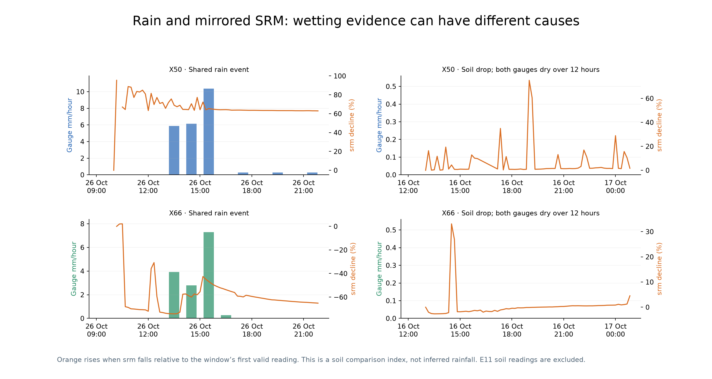
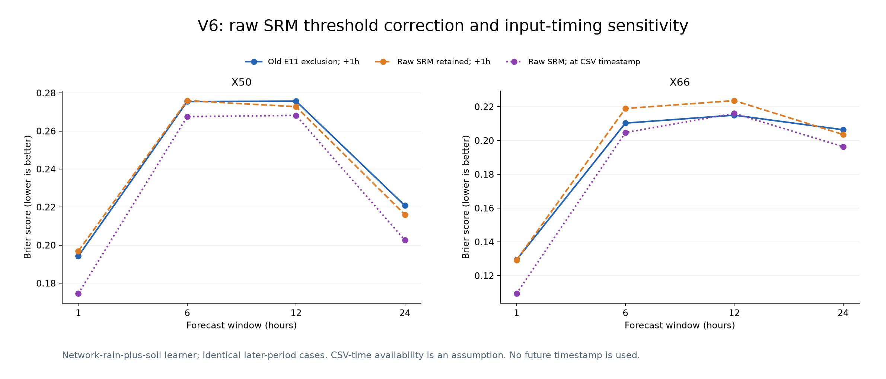
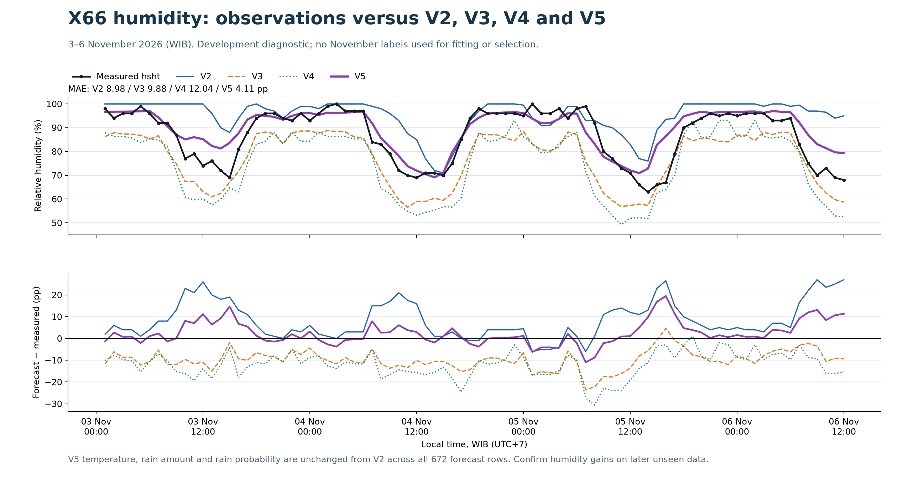
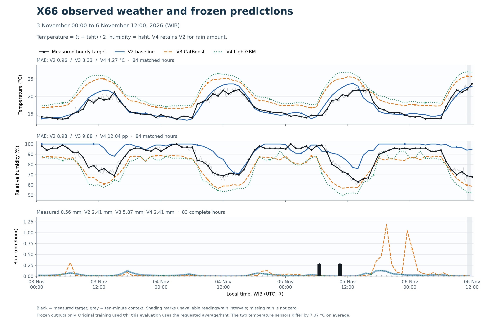
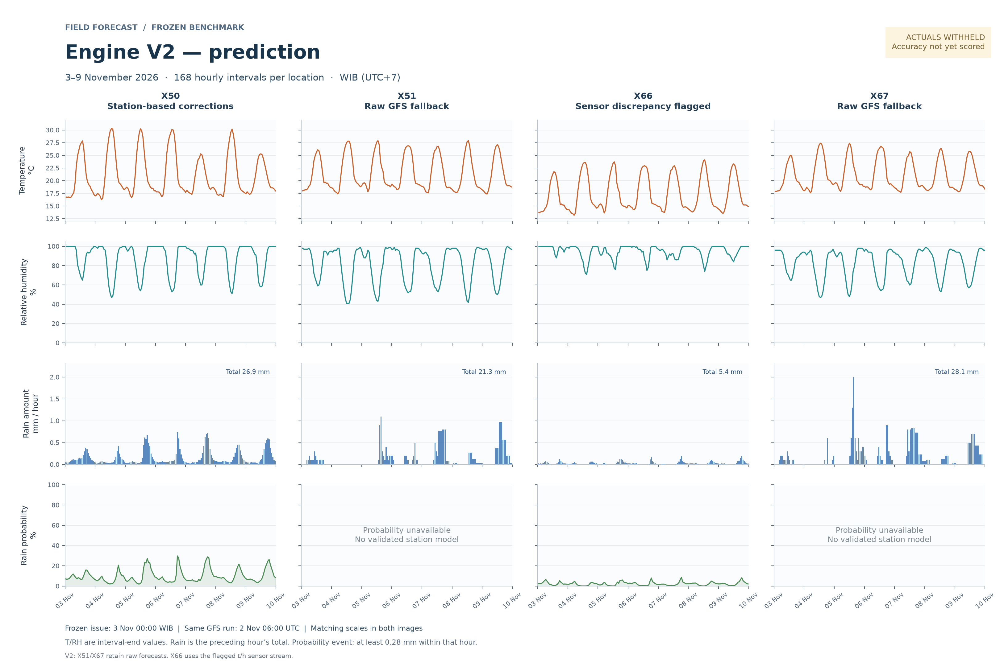
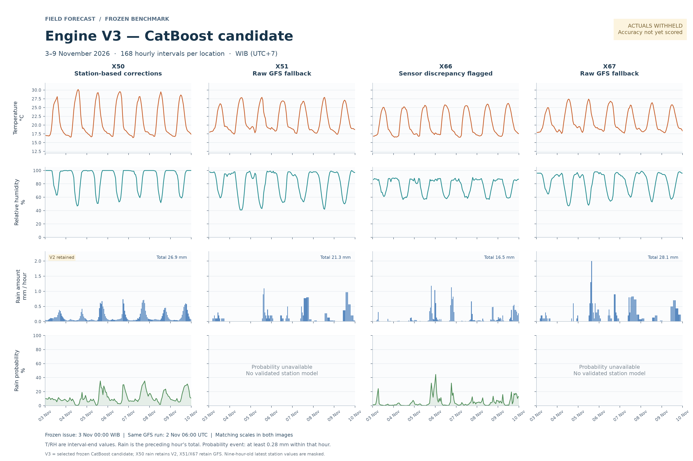
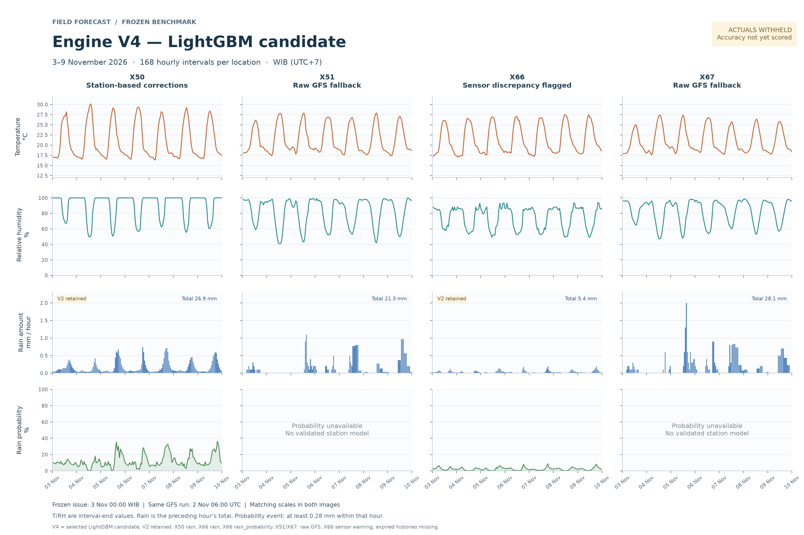

# Weather forecasting

Research monorepo for local forecasts using Open-Meteo forecasts and physical
weather-station measurements to learn statistical and machine-learning corrections.
The product goal is hourly temperature/humidity and rain probability/amount for
1-, 6-, 12- and 24-hour windows, with a seven-day extension where supported.

## Engine versions

Use the `main` branch. Each engine version has its own top-level folder;
version-specific branches and a shared `version/` parent are not used.

```text
weather-forecasting/
├── v2/
├── v3/
├── v4/
├── v5/
├── v6/
├── results/
└── docs/
```

| Folder | Status | Scope |
| --- | --- | --- |
| [v2](v2/README.md) | Frozen original baseline | GFS correction and blind 3–9 November 2026 benchmark |
| [v3](v3/README.md) | Frozen CatBoost candidate | Existing-input and station-history experiments; selected methods and all trained variants |
| [v4](v4/README.md) | Frozen LightGBM candidate | Same V2 data and V3 feature design; independently trained LightGBM variants |
| [v5](v5/README.md) | Frozen humidity candidate | X66 hsht ensemble; exact V2 temperature, rain amount and rain probability |
| [v6](v6/README.md) | Experimental rainfall candidate | X50/X66 rain and soil history; initial, weekly and E11-corrected models; V5 temperature/humidity retained |

Each version owns its source, dependencies, tests and experiment artifacts.
Earlier locked models and predictions are preserved.

## V6 rainfall research — X50 and X66

**V6 remains experimental: rainfall amount is not consistently more accurate than
raw GFS.** It uses the 6 August–6 November station exports to study rain, `sm` and
`srm`, and learns 1/6/12/24-hour rain occurrence and amount using fixed LightGBM
designs. Nearby recent rain helps occurrence prediction more consistently than
adding soil signals. Temperature and humidity retain all 672 V5 values exactly.

| Later-period development comparison | Amount RMSE lower than raw GFS | Nearby-rain Brier lower than weather-only learner |
| --- | ---: | ---: |
| Initial fixed fit | 1/8 groups | 8/8 groups |
| Weekly refresh | 0/8 groups | 8/8 groups |
| E11-corrected, assumed +1h availability | 0/8 groups | 8/8 groups |
| E11-corrected, assumed CSV-time availability | 1/8 groups | 8/8 groups |

Groups are two stations × four forecast windows, not independent storms. The
same 2,314 later-period windows are scored. Follow-ups were explored after seeing
earlier results, so these are development comparisons, not untouched blind tests.

E11 is treated as the user-described threshold flag: available positive raw
`srm` is retained, missing `sm` stays missing, and no 7000 cutoff is imposed.
After correction, SRM declines within an hour of 53/65 eligible X50 rain onsets
and 33/41 at X66. It also falls without recorded rain, so soil changes alone
cannot identify rain versus manual fertigation or supply rainfall millimetres.



The CSV contains assigned timestamps, without a separate arrival field. The
earlier +1h availability delay was an assumption. Both timing cases below exclude
future timestamps; CSV-time availability is a sensitivity, not confirmed live
delivery behavior. Lower Brier scores indicate better rain probabilities.



See [V6 instructions and findings](v6/README.md),
[three-month rain/soil overview](v6/output/rainfall_candidate_20261106/rain_soil_patterns_3months.png),
[corrected experiment report](v6/output/e11_corrected_20261106/report.md),
[corrected final rainfall models](v6/output/e11_corrected_20261106/raw_srm_1h/models/final/),
[stronger-control comparison](v6/output/review_20261106/review.md),
and [publication manifest](v6/publication.json).

## V5 humidity improvement — X66

V5 combines **V2 humidity**, a **V3-style CatBoost humidity learner retrained on
hsht**, and a **V4-style LightGBM humidity learner retrained on hsht**, with one
third weight each. October development validation selected this combination:
MAE improved from **7.282 to 6.739 percentage points** over 326 later-October cases.
Final tree learners use 3,507 pre-cutoff examples. No November labels enter fitting
or combination selection.

For the previously revealed 3–6 November observations (84 matched hours):

| Version | Humidity MAE, pp | Humidity RMSE, pp |
| --- | ---: | ---: |
| V2 | 8.98 | 11.85 |
| V3 | 9.88 | 10.76 |
| V4 | 12.04 | 13.40 |
| **V5** | **4.11** | **5.90** |

The new CatBoost hsht component alone scored 3.31 pp MAE on that November sample.
V5 retains the combination selected using October. November is a development
diagnostic because these observations were already revealed; later unseen data
must confirm the gain. The humidity update applies to X66; other stations retain V2.

**All 672 V5 temperature, rainfall amount and rain-probability values are exactly
V2.** The separate V6 rainfall experiments are described above.



See the [V5 source and instructions](v5/README.md),
[trained humidity models](v5/output/benchmark_20261103_humidity_v5/models/final/),
[selected combination](v5/output/benchmark_20261103_humidity_v5/selection.json),
[training report](v5/output/benchmark_20261103_humidity_v5/training_report.md),
and [November comparison](v5/output/evaluation_20261106/report.md).

## X66 observed comparison: 3–6 November 2026

**V2 has the lowest temperature MAE and humidity MAE for this partial period.**
V3 has the lowest humidity RMSE and follows humidity changes more closely.
V2 and V4 tie for rain amount/probability because V4 retained those V2 components.

The reference is **temperature = (t + tsht) / 2** and **humidity = hsht**.
There are **84 matched hourly temperature/humidity targets** and **83 complete
rain hours**, ending 6 November at 12:00 WIB. Lower errors are better.

| Model | Temperature MAE, °C | Humidity MAE, pp | Humidity RMSE, pp | Rain RMSE, mm/hour |
| --- | ---: | ---: | ---: | ---: |
| V2 | **0.96** | **8.98** | 11.85 | **0.059** |
| V3 — CatBoost | 3.33 | 9.88 | **10.76** | 0.209 |
| V4 — LightGBM | 4.27 | 12.04 | 13.40 | **0.059** |

Matched rain totals: **0.56 mm measured**, **2.41 mm V2/V4**, **5.87 mm V3**.
Only two wet hours were observed; all versions missed those hours under the
0.28 mm/hour forecast-amount threshold. These rain scores are dominated by dry hours.

The two temperature sensors differ by **7.37°C on average**. The frozen models
were trained against the earlier t/h stream; these results use the newly requested
average/hsht reference. This is a reference-specific comparison over a partial
week, not a universal model ranking. No model was refitted.



Read the [full X66 analysis](results/x66/20261106/README.md),
[error and accumulated-rain graph](results/x66/20261106/X66_errors_and_rain_cumulative.png),
and [matched observations and forecasts](results/x66/20261106/hourly_comparison.csv).

## V2, V3 and V4 prediction comparison

All three graphs show **3–9 November 2026**, with 168 hourly intervals for each of
X50, X51, X66 and X67, in **WIB (UTC+7)**. They use the same archived GFS run
initialized on 2 November at 06:00 UTC and matching axis ranges.
**These forecasts were frozen with November measurements withheld.**

### Engine V2



### Engine V3 — CatBoost



### Engine V4 — LightGBM



V3 retains V2 for **X50 rain amount**. V4 retains V2 for **X50/X66 rain amounts**
and **X66 rain probability**. X51/X67 retain raw GFS in all versions. X66 retains the user-selected t/h stream and its sensor
discrepancy warning. Temperature/humidity are interval-end values; rain is the
preceding hour's total. Hourly rain probability means at least 0.28 mm.

## October validation

These values were used to select methods; they are **not untouched final-test accuracy**.

| X50 metric — lower is better | Original V2 | V3 selected method | V4 selected method |
| --- | ---: | ---: | ---: |
| Temperature MAE, °C | 1.748 | 1.704 | 1.696 |
| Humidity MAE, percentage points | 9.748 | 6.219 | 6.831 |
| Rain probability Brier score | 0.1086 | 0.1047 | 0.1056 |
| Rain amount RMSE, mm/hour | 1.670 | 1.670 — V2 retained | 1.670 — V2 retained |

V4 uses V2’s archived observations/forecasts and V3’s feature/evaluation design.
It learns independently; CatBoost predictions and weights are not training inputs.
V3/V4 training-row signatures and frozen feature values match exactly.

The history-only experiment has a matched exact-run control. At the frozen issue,
station readings are about nine hours old; expired latest/rolling features remain
missing. The larger X66 improvements measure agreement with its flagged sensor
stream. Joint 6/12/24-hour probabilities and 50 km spatial transfer remain unproven.

Read the [V4 training report](v4/output/benchmark_20261103_lightgbm/training_report.md),
[V4 validation graph](v4/output/benchmark_20261103_lightgbm/validation.png),
[V3 training report](v3/output/benchmark_20261103_catboost/training_report.md),
[V2 baseline report](v2/output/engine_v2/benchmark_20261103/baseline_report.md),
and [confirmed product scope](docs/PROJECT.md).

## Verify and run

```sh
# Verify all three frozen snapshots and comparison graphs; Python standard library only.
python v4/verify_package.py
# Verify V5 trained models, unchanged V2 components and humidity results.
python v5/verify_package.py
# Verify V6 models, rainfall metrics and preserved V5 temperature/humidity.
python v6/verify_package.py
# Verify the published X66 observations and comparison metrics.
python results/x66/20261106/verify_results.py
```

See [V2 instructions](v2/README.md), [V3 instructions](v3/README.md)
and [V4 instructions](v4/README.md)
for dependencies, tests and data requirements. V3's internal identifier remains
`engine_v2_catboost.1` to preserve the original sealed experiment.

## Data and provenance

The repository includes source, trained models, frozen forecasts, reports, plots,
derived GFS history and sealed packages. Raw station exports, raw provider-response
archives, local databases and runtime/download caches remain outside Git.
The import manifests and frozen source are historical records and retain their
original paths. Current entry points are separate `v2/` through `v6/` folders; the
[layout migration record](LAYOUT_MIGRATION.json) records the folder correction.
Some original provenance records contain local filesystem paths and historical
pre-publication notes. See [V2 data requirements](v2/DATA.md).

Open-Meteo weather-data attribution: https://open-meteo.com/ (CC BY 4.0).
No software license has been selected for this repository.
