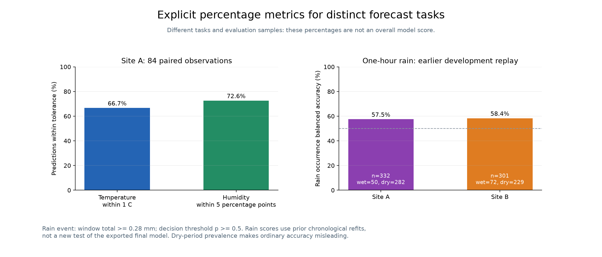
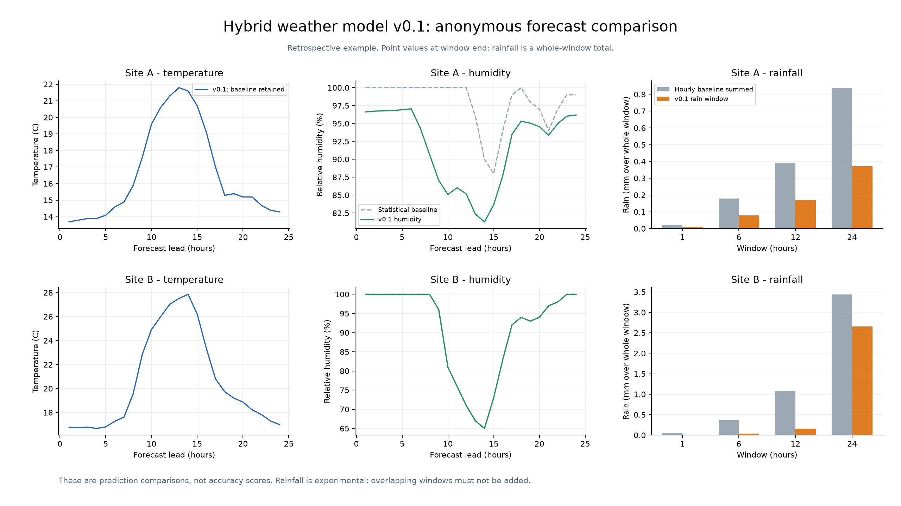

# Hybrid Weather Forecasting Model v0.1

A public, de-identified hybrid forecasting model. It combines numerical weather
forecasts with statistical corrections, a humidity ensemble, and direct
rain-window learners. It uses anonymous **Site A–D** labels and portable paths.

The release files exclude project-specific organization names, original telemetry labels,
device identifiers, precise coordinates, private network addresses, personal
paths and identifying historical archives. The numerical models are retained
after metadata cleaning and feature-label replacement.

## Percentage accuracy with explicit definitions

The point results below use **84 paired observations at Site A** from a
retrospective diagnostic that had already been inspected. These are
within-tolerance rates, not a universal model-accuracy percentage.

| Task | Definition | Result | Count |
| --- | --- | ---: | ---: |
| Temperature | Absolute error <= 1 degree C | **66.7%** | 56 / 84 |
| Humidity | Absolute error <= 5 humidity percentage points | **72.6%** | 61 / 84 |
| Baseline humidity | Same 5-point tolerance | 48.8% | 41 / 84 |

Humidity MAE is **4.111 percentage points**, compared with **8.982** for the
statistical baseline: **54.2% lower MAE**. That number is an error reduction,
not an accuracy percentage. Temperature MAE is **0.957 degrees C**.



### Rainfall development evidence

Rain-event scores come from an **earlier chronological rolling-fit development
experiment**, not a new benchmark of the exported final weights. Event threshold:
window rain >= 0.28 mm. Classification threshold: probability >= 0.5.

| One-hour group | Balanced accuracy | Ordinary accuracy | All-dry accuracy | Wet / dry cases |
| --- | ---: | ---: | ---: | ---: |
| Site A | **57.5%** | 83.7% | 84.9% | 50 / 282 |
| Site B | **58.4%** | 75.7% | 76.1% | 72 / 229 |

Ordinary accuracy is dominated by dry cases and is below the all-dry baseline
here. Rainfall amount has not consistently improved over raw weather forecasts.
All 1/6/12/24-hour groups, confusion counts, Brier scores and amount RMSE are in
[the rainfall score table](v0.1/results/rainfall_development_scores.csv).
There is **no single overall accuracy percentage** for temperature, humidity
and rainfall together. Read [metric definitions and scope](v0.1/docs/METRICS.md).

## Forecasts and comparison graphs



- [Observations versus predictions](v0.1/graphs/observations_vs_predictions.png)
- [Seven-day point forecasts](v0.1/graphs/seven_day_forecast.png)
- [Rainfall development comparison](v0.1/graphs/rainfall_development_comparison.png)

Axes use relative forecast hours and anonymous labels. The demonstrations are
historical replays, not current live forecasts.

## What is included

| Output | Coverage |
| --- | --- |
| Temperature | Statistical baseline at all configured sites |
| Humidity | Baseline/CatBoost/LightGBM ensemble at Site A; retained fallback elsewhere |
| Rain amount and event probability | Selected direct 1/6/12/24-hour routes at Sites A/B |
| Other-site rain | Baseline fallback; unsupported multi-hour probabilities are null |

The package contains cleaned trained models, standalone inference code,
anonymous demonstration inputs/outputs, reproducible metric data, graphs,
tests and a package manifest. It needs no old version archive.

```text
v0.1/
  engine.py              model inference and composition
  models/                cleaned numerical model files
  data/                  anonymous examples and evaluation pairs
  results/               defined metrics and comparison tables
  graphs/                anonymous plots
  docs/                  usage, methods, limits and privacy scope
  tests/                 inference, scoring and privacy checks
```

## Verify and run

Use Python 3.12 from the repository root:

```sh
# Standard library only: check hashes, structural patterns and metric arithmetic.
python v0.1/verify_package.py
# Install in your selected Python environment.
python -m pip install -r v0.1/requirements.txt
python -m unittest discover -s v0.1/tests -v
python v0.1/run.py replay
# Regenerate the figures from the anonymous files.
python v0.1/plot_results.py
```

See [usage](v0.1/docs/USAGE.md), [methods](v0.1/docs/METHODS.md),
[limitations](v0.1/docs/LIMITATIONS.md), and [privacy scope](v0.1/docs/PRIVACY.md).

## Limits and privacy scope

This is a content-cleaning release on a separate branch. **Existing branches
and Git history are unchanged** and may still contain earlier identifiers.
The GitHub account and commit metadata are outside the file-content cleaning
scope. De-identification is not a guarantee that published numerical data cannot
be matched with previously public data.

The model has no new blind accuracy benchmark or automatic live data pipeline.
Support is site-specific, rainfall remains experimental, and observation
availability retains an assumed one-hour delay. Separate rain windows overlap
and do not establish a coherent joint distribution. Soil wetting can be rain
or manual irrigation/fertigation. Full limitations are retained in the docs.

Weather-data attribution: [Open-Meteo](https://open-meteo.com/) (CC BY 4.0).
No software license has been selected for this repository.
