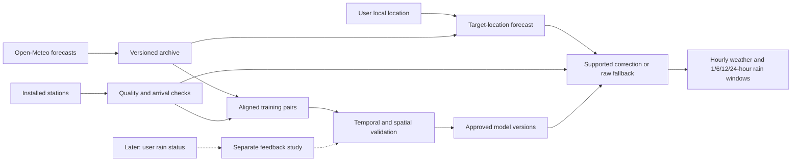

# Research: forecasts corrected with a weather station network

Research date: 5 November 2026. Scope: evidence review and recommended research design, not a trained model or measured accuracy result.

## Research conclusion

There is enough information to start this prototype. Use Open-Meteo for the atmospheric forecast at each user's location, then learn statistical corrections from the installed station network. Evaluate rain occurrence, rain amount, temperature, humidity and transfer to places without a station separately.

The difficult objective is correcting a forecast roughly 50 km from the network. Published work supports researching spatial postprocessing, including terrain-aware methods, but does not establish skill for this network in Indonesia. The four supplied stations span only approximately 4 km. Evidence collected within that cluster cannot establish performance 50 km away.

Start with small, auditable statistical models and preserve raw-forecast fallback. A large neural network, a fixed distance rule or the prototype's constants 72 and 30 would not remove the need for validation. Exact expected accuracy, the supported radius and the necessary training duration cannot be determined from literature alone.

## 1. Confirmed product and pilot

Each user receives the forecast for their own location. Majalengka and Tasikmalaya are examples, rather than a request to display the whole network. Required outputs are rain probability and amount for 1, 6, 12 and 24 hours, plus hourly temperature and relative humidity. Seven days is optional. ThingsBoard is excluded from the current integration scope.

Two input categories drive the initial version: Open-Meteo forecasts and installed station measurements. Static geographic metadata describes locations/stations, rather than adding another live weather provider. Later, users may report `dry`, `rain` or `heavy_rain`, without entering mm. Twenty reports/day was illustrative, not a quota.

The user confirmed research first and whole-hour windows. At a request time of 10:23 local time, the initial summaries can be labeled 11:00–12:00, 11:00–17:00, 11:00–23:00 and 11:00–11:00 next day. This leaves the unfinished clock hour outside those summaries; labels must make that visible. Forecast update frequency is a separate decision.

| Pilot station | Latitude | Longitude | Provided elevation |
| --- | ---: | ---: | ---: |
| X50 | -7.397703 | 107.833976 | 1230 m, estimated |
| X51 | -7.371024609 | 107.8115768 | 1190 m |
| X66 | -7.372810364 | 107.8136597 | 1299 m |
| X67 | -7.404071808 | 107.8261642 | 1161 m |

Coordinates/heights are user-supplied, not independently surveyed. Haversine calculations with Earth radius 6371 km give X51–X66 approximately 0.304 km, X50–X67 1.115 km and the maximum separation, X51–X67, 4.011 km. Heights span 1161–1299 m. This compact highland sample provides little evidence about different elevations or regional climates.

## 2. What the evidence supports

| Question | Evidence | Implication for this project |
| --- | --- | --- |
| Can postprocessing improve precipitation guidance? | Scheuerer and Hamill develop probabilistic precipitation postprocessing using ensemble statistics and a censored shifted-gamma distribution. | A predictive distribution is a supported research direction; the paper does not validate our earlier multiplier. [NOAA-hosted paper](https://repository.library.noaa.gov/view/noaa/14608) |
| Can correction work away from training stations? | Friedli, Ginsbourger and Bhend investigate daily precipitation in Switzerland using topographic similarity and selective raw-model fallback. | Research location similarity rather than a universal radius. Their geography and daily leads differ from our hourly tropical task. [Research paper](https://arxiv.org/abs/1912.11827) |
| Does local Indonesian geography matter? | Lestari et al. examine subdaily western-Java rain with radar/in-situ data, including spatial and temporal variation. | Test terrain and hour-of-day effects locally. Do not presume that a highland correction transfers everywhere. [Western Java study](https://journals.ametsoc.org/view/journals/apme/61/9/JAMC-D-21-0041.1.xml) |
| Is near-term rain timing just an amount adjustment? | WMO describes nowcasting up to six hours using timely surface, radar, satellite and other observations. | Investigate hourly timing skill, without promising radar-like shower tracking from distant gauges. [WMO observing requirements](https://space.oscar.wmo.int/applicationareas/view/2_3_nowcasting_very_short_range_forecasting) |
| Are qualitative citizen observations useful? | NOAA's mPING archives local weather reports for forecast research and verification. | User rain status is a plausible future stream; its benefit here needs an independent experiment. [NOAA project account](https://inside.nssl.noaa.gov/nsslnews/2017/05/weather-reports-from-citizens-provide-research-input/) |

These findings establish research directions, not an Indonesia accuracy percentage. No study reviewed establishes that four stations within 4 km reliably correct hourly rain 50 km away.

## 3. Open-Meteo data choices

The Forecast API offers hourly temperature/humidity, precipitation amounts and precipitation probability. Temperature/humidity describe the indicated instant; precipitation describes the preceding hour. The documented probability event is precipitation greater than 0.1 mm in that preceding hour. Best Match can select different underlying models by variable/horizon. Requested and returned grid coordinates can differ, and elevation-based downscaling is already applied. Preserve those distinctions rather than attributing every residual to grid distance. For Indonesia, 15-minute output is interpolated from hourly data and does not independently resolve shower timing. [Forecast API definitions](https://open-meteo.com/en/docs)

Retain Best Match as a benchmark and evaluate explicit globally applicable models separately, starting with the existing GFS/ECMWF candidates. Verify each model's actual variables, units, horizon, grid and missing values. Two deterministic forecasts are comparison candidates, not enough members to claim a calibrated probability distribution. No model is declared best for Indonesia before local testing.

Three archive products have different roles:

- **Previous Model Runs:** fixed 1–7-day lead offsets, useful for day-ahead comparisons; they do not reconstruct every 1–24-hour forecast from an individually identified run. [Previous Runs documentation](https://open-meteo.com/en/docs/previous-runs-api)
- **Single Runs:** complete initialized runs. Current documentation lists ECMWF IFS HRES from March 2024 and most other models from April 2026. Initialization precedes publication; a backtest must respect availability delay. Check specific model/date and operational-versus-hindcast provenance before treating a run as historically available to users. [Single Runs documentation](https://open-meteo.com/en/docs/single-runs-api)
- **Individual ensemble members:** trajectories useful for window probabilities and predictive amounts. Documentation currently retains members for only up to three days, so preserve relevant runs locally. Longer-lived ensemble mean/spread archives do not reconstruct member-by-member time dependence. [Ensemble API](https://open-meteo.com/en/docs/ensemble-api), [Ensemble Mean API](https://open-meteo.com/en/docs/ensemble-mean-api)

The existing local year has 8760 target hours per deterministic model at the old area reference. Its verification report shows no missing GFS values and 387 missing ECMWF values across 21 series. These remain exploratory assets; their coordinates and fixed-day leads do not match the revised core experiment. New station requests should use the confirmed coordinates. Preserve older files with original provenance.

## 4. Define the forecast quantities

### Rain amount

For a forecast using information available at time t, let R_h be accumulated rain in the h-th future complete clock-hour interval. For H in {1, 6, 12, 24}:

`S_H = R_1 + ... + R_H`.

Expected amount is the predictive mean of S_H, including dry outcomes. It differs from the amount conditional on rain occurring. Label a deterministic value as a model forecast amount until a calibrated predictive interpretation has been established.

Report mm and a labeled predictive interval once its coverage has passed testing. A min/max across two models is not a calibrated confidence interval. Expected totals add consistently when generated from the same hourly trajectory. Quantiles generally do not: a six-hour 90th percentile is not the sum of six hourly 90th percentiles.

### Rain probability

Two reasonable events are different:

1. At least one hour exceeds a specified hourly rain threshold.
2. Total accumulated rain S_H exceeds a specified window threshold.

Choose one primary event and retain its threshold, operator and interval in each response. The recommended initial research target is measurable accumulated rain over the window, with thresholds compatible with gauge resolution. X50's one-tip increment is 0.28 mm. This is a measurement constraint, not a universal rain/no-rain or heavy-rain threshold. A provider probability defined above 0.1 mm cannot silently become the probability of at least 0.28 mm.

For M aligned ensemble trajectories, a raw estimate of the second event is:

`p_H = count(member window totals exceeding the threshold) / M`.

Calculate each total within the same member and initialized run. Ensemble fractions are a baseline requiring calibration, not automatically reliable probabilities. With only hourly probabilities, joint time dependence is unknown: do not add, average, take the maximum or assume independence and call the result the true window probability. A separately trained window-event model is another option when suitable data exist; otherwise show that probability as unavailable.

Postprocessing individual hours also needs temporal dependence or coherent window outputs. KNMI's precipitation research explicitly evaluates probabilistic postprocessing and multivariate structuring. It supports treating dependence as a design issue, not importing its Netherlands skill estimates into this pilot. [KNMI publication](https://www.knmi.nl/kennis-en-datacentrum/publicatie/statistical-postprocessing-and-multivariate-structuring-of-high-resolution-ensemble-precipitation-forecasts)

### Temperature, humidity and rain timing

Forecast temperature in °C and relative humidity in percent at upcoming whole-hour instants. Match observations using a declared tolerance or observation interpolation rule. Averaging the preceding hour automatically would create a different target. Retain gaps and quality flags. Humidity errors are measured in percentage points.

Initially describe timing through hourly rain probabilities or an explicitly defined onset-window forecast. Specify measurable rain, the dry period separating events and a timing tolerance before scoring. Avoid minute-level onset claims from hourly interpolated amounts.

## 5. Recommended model experiments

These are proposed experiments, not formulas copied unchanged from the sources or validated system behavior.

| Stage | Candidate | Research question |
| --- | --- | --- |
| Baselines | Raw Best Match, explicit GFS/ECMWF, simple average, available raw ensemble distribution | How hard is it to beat the inputs? |
| Temperature/humidity | Small regularized residual model by lead/local hour; add geographic context only when supported | Are repeatable errors present? |
| Rain baseline | Separate occurrence and positive amount; retain a simple multiplier as a control | Can probability and amount both improve? |
| Probabilistic rain | Regularized occurrence regression plus positive-amount distribution; compare EMOS-style approaches with ensemble data | Do probabilities and predictive amounts become reliable? |
| Spatial extension | Pooled postprocessing with location similarity and a support gate | Does it help at an entirely withheld location? |
| Later complexity | Quantile regression forests or other flexible models after simple baselines | Does flexibility improve independent tests? |

A temperature schematic is:

`corrected target = target model forecast + support strength × estimated target residual`.

The residual can depend on station forecast errors, elevation relationships, local time, lead and modeled weather patterns. Learn support strength and spatial scales from validation. If support is absent, strength is zero and the raw forecast remains available. This candidate has no preselected 50 km radius or replacement magic constants.

Distinguish long-term bias from a recent observation innovation. A station's error this morning is not necessarily tomorrow's correction. Include observation age, arrival time and validated persistence. Because elevation adjustment already exists upstream, do not stack an assumed lapse-rate correction onto it without testing.

A positive rain multiplier preserves zeros and timing, so it cannot recover missed wet events or shift showers. It remains a useful control, not the complete product. A two-part model represents dry outcomes and positive amounts, with an explicit probability event/display threshold. Separately trained horizons need consistency checks so longer nested windows do not contradict shorter ones under the same event definition.

The constants 72 and 30, original correction bounds, rain threshold and minimum samples were prototype choices. Treat them as experimental parameters and allow zero correction. Dense 10-minute samples or many correlated lead times do not create equally many independent storms.

## 6. Correction away from the stations

Treat 50 km as a research scenario, not a guarantee. Examine how station information relates to target errors through distance, elevation, terrain, coastal context, season, lead and sensor quality. Static features need documented provenance; start small rather than fitting a complex geographic model to four sites.

Normalized inverse-distance weights alone do not provide a fallback: a single very distant station still receives normalized weight one. A separate support gate must weaken or disable correction outside demonstrated conditions. Support is specific to variable and horizon; useful temperature correction does not establish useful next-hour rain correction.

Use three tests:

1. **Temporal holdout:** can history improve later forecasts at the same observed site?
2. **Whole-site holdout:** train without any labels from one station and predict there using permitted information from the others. This tests transfer over actual network separations.
3. **Distant/terrain holdout:** obtain independent gauge, temperature and humidity observations near the intended remote target. Withhold that site's labels from training and deployment inputs during the experiment. This tests the far-from-network claim.

A temporary verification station remains in the station-measurement input category; it does not add a third production weather provider. Independently measured public stations may also help when access, quality and time resolution are suitable. Model-filled data or reanalysis cannot replace measured target truth for this claim.

The present four-site cluster cannot establish nationwide skill. Expand the tested envelope through regional deployments. Distinguish forecast availability from evidence of a beneficial correction and retain raw forecasts outside the supported envelope.

## 7. Observation quality, freshness and leakage

The strongest local data evidence is X50's 56,458 imported readings with field flags and checked rainfall-counter consistency. Earlier notes identify X51 as stale and X67 rain as faulty; coordinates alone do not reconfirm current healthy periods. Inventory readiness per sensor. Valid X67 temperature/humidity can remain eligible when its rainfall is excluded.

- Preserve original readings, identity, measurement timestamps, raw units, provenance and variable-specific quality.
- Rain needs verified interval amounts and endpoints. Incomplete coverage, resets and bad gauges produce missing targets, not dry ones. Cross-hour measurement intervals need a declared treatment; uniform rain within an interval must not be silently invented.
- Match temperature/humidity instants separately from rain sums; retain sample-time offsets.
- Earlier information says 10-minute samples are uploaded hourly. That delay affects next-hour forecasting and must be simulated. Capture measurement and reception timestamps separately for new data.
- When historical arrival times are unknown, declare a conservative delay scenario and sensitivity tests rather than fabricate exact arrival times.
- Preserve forecast source/model/recipe, initialization, known publication or first-seen time, target and retrieval. Initialization is not availability; reanalysis is not an issued forecast.

At each simulated issue time, features can include only then-available information. Fit on targets whose intervals have ended and observations have arrived. Keep boundaries clear for overlapping 24-hour targets so future outcomes cannot leak through other rows. Refit or invalidate corrections when the model recipe changes.

## 8. Evaluation and activation

Use rolling chronological train/validation/test periods. Freeze choices before final testing; stratify by season/location when possible. A withheld site's labels must also be excluded from normalization, feature fitting and tuning. Other stations' concurrent readings are permitted only when received by issuance and intended as production inputs.

| Dimension | Proposed measurements |
| --- | --- |
| Temperature/humidity | MAE, bias and predictive-interval coverage; by lead/local hour |
| Rain probability | Brier score, reliability and skill against training-only climatology and appropriate raw forecasts |
| Rain amount | MAE/bias on all valid windows and wet subsets; CRPS for full distributions |
| Events | Hits, misses, false alarms, precision/recall and counts at declared thresholds |
| Timing | Onset-window skill and timing error with a predeclared tolerance |
| Spatial transfer | The same scores at wholly withheld sites and tested terrain/distance regimes |
| Service | Coverage, forecast/sensor age, fallback frequency and missing outputs |

Brier score assesses probability error for a specified event; CRPS evaluates a predictive distribution. ECMWF also uses block-based uncertainty assessment in verification. These are suitable tools to consider, not evidence that this prototype has skill. [ECMWF verification guide](https://confluence.ecmwf.int/spaces/WLS/pages/394992254/Verification)

Compare on identical valid cases. Estimate uncertainty with day/storm blocks rather than treating overlapping windows as independent. Predeclare activation: improvement in the agreed primary score with enough evidence, adequate coverage and acceptable misses/false alarms. Set tolerances for the pilot's intended use. Do not promise a 10% improvement or 90% accuracy before measuring baselines.

Include raw-fallback cases in system results. Corrections may be supported for one variable/horizon/location and unsupported for another. Disable only the unsupported component rather than discarding every forecast.

## 9. Later user feedback

Store status, observation time, server receipt time, location/cell and its accuracy, pseudonymous reporter identity, and quality/duplicate flags. A report describes current weather, not a prediction. No report means unknown, not dry.

Proposed uses progress from discrepancy monitoring, to wet/dry checking, to tested short-range updates. Never map `heavy_rain` to a fixed mm/h value without instrument-based calibration. A 10:23 report cannot verify an entire 10:00–11:00 rain amount.

Twenty reports/day may concentrate in one town or storm rather than provide 20 independent examples. Track unique locations/times, repeated reports, event coverage and missing dry reports. Prevent one reporter from dominating a local estimate, assess location/time consistency and cross-check with sensors. Encourage dry reports too, so the sample is not entirely rain-triggered.

Keep subjective heavy-rain reports distinct from official numerical intensity categories. Before activating feedback, compare models with/without reports in held-out periods and locations using only reports received by issuance. Verify amounts against independent instruments. Never verify a forecast solely against a report used to create it.

## 10. Prototype architecture and response

A scheduled collector, local database/files, a training command and small inference API are enough for research. Retain the existing dashboard as a development viewer until evaluation supports a real forecast product. A ThingsBoard service, distributed platform or LLM is not required for this experiment.

Each response identifies the target location, local timezone, issue/retrieval time, window endpoints, source recipe, forecast age, corrected/raw status, support reason and model version. Probabilities carry event definitions; amounts specify mm and whether they are deterministic forecasts, predictive means or conditional amounts. Missing probabilities remain missing.

Cache provider requests by location/recipe, reuse shared data appropriately and retain target elevation effects. Avoid one provider request per page view. Recompute on new runs or meaningful station arrivals; select a schedule after measuring latency. Open-Meteo documents eventually consistent updates, so first-seen availability should not be equated with initialization cycles. [Model update documentation](https://open-meteo.com/en/docs/model-updates)

Use UTC internally and the target's local timezone for display. Indonesia spans WIB, WITA and WIT; the earlier global `Asia/Jakarta` assumption must become pilot-specific. [BMKG time reference](https://www.bmkg.go.id/tanda-waktu)

## 11. Access, costs and optional comparisons

The user chose research first. Open-Meteo's current free-service terms require noncommercial use and fewer than 10,000 calls/day, 5,000/hour and 600/minute, with attribution. They do not establish that every later free/public or business use qualifies. Recheck the intended deployment before release. [Provider terms](https://open-meteo.com/en/terms)

Budget by effective call weight, forecast locations, models, variables and updates, not registered users alone. Ensemble/multi-location requests can consume multiple quota units. The current pricing matrix also distinguishes archive access by plan; do not assume every paid plan includes every research API. Exact spending needs a usage forecast and hosting choice. This research commits to no subscription. [Provider pricing/access matrix](https://open-meteo.com/en/pricing)

BMKG is an optional later comparison, not a new required input: its documented village feed offers three-hourly forecasts for three days. That feed alone does not satisfy our hourly rain-amount requirement. Radar/satellite data could be researched later if accessible, but are not silently added to the two-input prototype. [BMKG forecast documentation](https://data.bmkg.go.id/prakiraan-cuaca/)

## 12. Deliverables and remaining information

| Order | Deliverable | Completion criterion |
| --- | --- | --- |
| 1 | Station readiness inventory | Coordinate/elevation provenance, valid histories, sensor faults and current latency |
| 2 | Reproducible forecast archive | Station-coordinate queries, model/run/availability metadata, coverage audit and ensemble capture |
| 3 | Matched whole-hour dataset | Auditable rain sums, instantaneous temperature/humidity targets and arrival assumptions |
| 4 | Baseline report | Same-case model, average and probability scores with coverage/event counts |
| 5 | Temporal correction experiment | Earlier tuning, later testing and fallback cases included |
| 6 | Local spatial experiment | Entire station withheld and temporal holdout retained; claims limited to tested separations |
| 7 | Distant transfer experiment | Independent remote-target measurements withheld; 50 km objective tested directly |
| 8 | Research interface | Local windows/timezone, freshness, quantity definitions and correction status |
| 9 | Feedback study | Quality design and independent comparison before reports influence predictions |

Research can proceed now. Training additionally needs usable history for X51/X66/X67 or an X50-only starting dataset, current fault periods and observation/reception timing. Surveyed heights, exposure/maintenance notes and pressure type improve metadata but are not all prerequisites for a first temperature/humidity/rain baseline. Distant transfer needs independent target measurements.

Product name, UI technology, production hosting and a paid-service budget can wait. Numerical event definitions, update cadence and activation criteria should be fixed before accepting the relevant experiment or output.

## Evidence boundaries

This work reviewed official Open-Meteo documentation, WMO requirements, NOAA/KNMI/ECMWF material and identified papers, inspected project code/metadata, and calculated separations from the supplied coordinates. It did not download new histories, test every documented API/model/date combination, inspect instruments, fit real corrections, establish a radius, measure improvement or deploy a service. Some publisher full text was unavailable; the western-Java finding is limited to its accessible abstract/search excerpt. Recheck API capabilities and terms at implementation.
