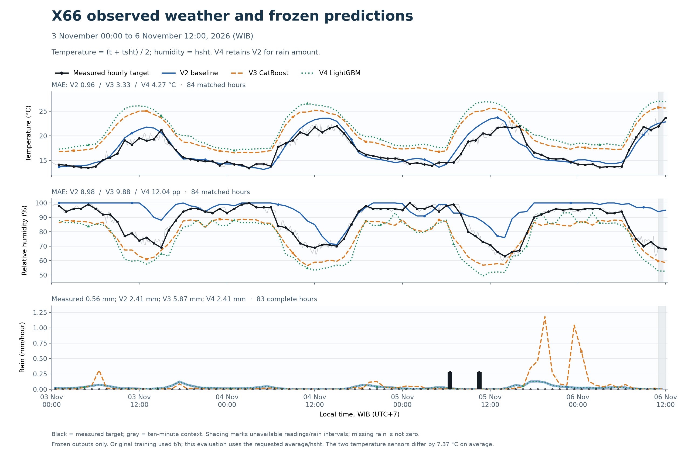
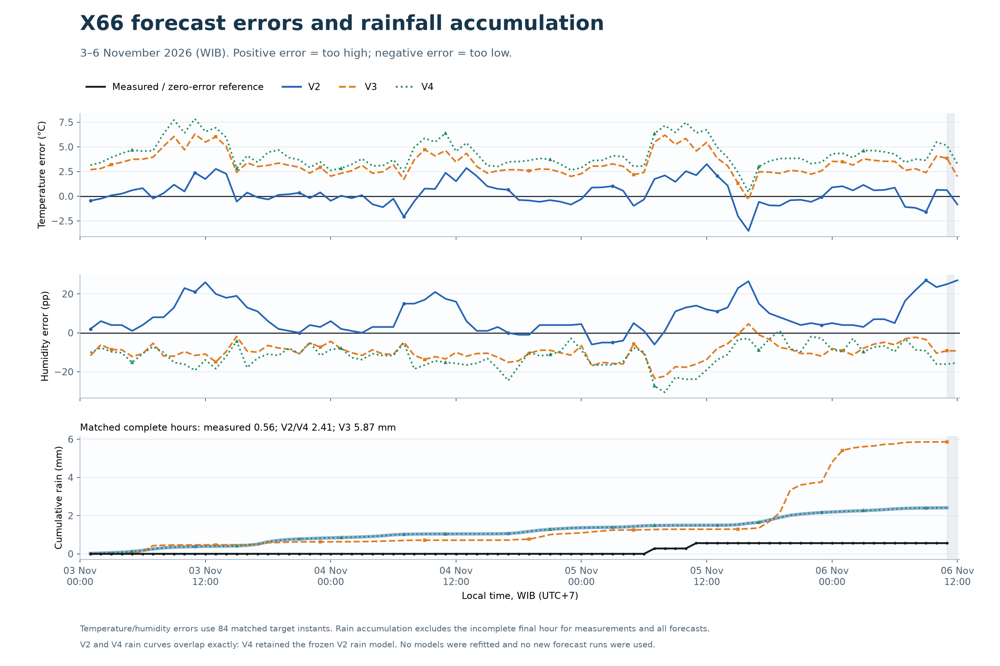

# X66: measured weather versus frozen V2, V3 and V4

**For the requested reference, V2 is closest for temperature and has the lowest humidity MAE. V3 has the lowest humidity RMSE and follows humidity changes more closely. V2 and V4 tie for rain because V4 retained V2’s rain model.**

The supplied file contains 502 readings from 3 November 2026 00:00:08 through 6 November 12:00:08 WIB. Scored hourly targets are 3 November 01:00 through 6 November 12:00: 84 temperature/humidity instants and 83 complete rain hours. The 40-minute gap on 6 November 11:00:08–11:40:08 invalidates the 11:00–12:00 rain interval but removes no hourly temperature/humidity target.

## Accuracy on identical matched observations

MAE is the average absolute forecast error; RMSE gives larger errors more weight. Lower is better.

| Model | T MAE °C | T RMSE °C | RH MAE pp | RH RMSE pp | Rain MAE mm/h | Rain RMSE mm/h |
| --- | ---: | ---: | ---: | ---: | ---: | ---: |
| V2 | 0.957 | 1.241 | 8.982 | 11.850 | 0.035 | 0.059 |
| V3 | 3.334 | 3.533 | 9.877 | 10.759 | 0.077 | 0.209 |
| V4 | 4.273 | 4.492 | 12.044 | 13.398 | 0.035 | 0.059 |

## Patterns and bias

| Model | T bias °C | T correlation | RH bias pp | RH correlation |
| --- | ---: | ---: | ---: | ---: |
| V2 | +0.330 | 0.934 | +8.315 | 0.659 |
| V3 | +3.325 | 0.930 | -9.766 | 0.920 |
| V4 | +4.273 | 0.918 | -12.017 | 0.908 |

Bias means forecast minus measurement. V3 and V4 follow the temperature cycle but are too warm against the combined reference. V2 has a smaller average temperature offset. V2 humidity is too high on average; V3/V4 humidity is too low. V3’s stronger humidity correlation describes the pattern, while its dry offset keeps its MAE above V2’s. This is why humidity has a different winner under MAE and RMSE.





## Day and night

| Target period WIB | Model | T MAE °C | T bias °C | RH MAE pp | RH bias pp |
| --- | --- | ---: | ---: | ---: | ---: |
| 06:00–17:00 | V2 | 1.359 | +0.669 | 13.767 | +13.488 |
| 06:00–17:00 | V3 | 3.799 | +3.783 | 10.264 | -10.049 |
| 06:00–17:00 | V4 | 4.827 | +4.827 | 14.410 | -14.410 |
| 18:00–05:00 | V2 | 0.536 | -0.025 | 3.963 | +2.890 |
| 18:00–05:00 | V3 | 2.845 | +2.845 | 9.470 | -9.470 |
| 18:00–05:00 | V4 | 3.693 | +3.693 | 9.561 | -9.507 |

V3 has the lower daytime humidity MAE (10.26 pp versus V2’s 13.77 pp). V2 is closer at night (3.96 pp versus V3’s 9.47 pp), which gives it the lower full-period humidity MAE.

## Rain amount and event probability

| Model | Observed matched rain mm | Predicted matched rain mm | Brier score |
| --- | ---: | ---: | ---: |
| V2 | 0.56 | 2.41 | 0.02441 |
| V3 | 0.56 | 5.87 | 0.03234 |
| V4 | 0.56 | 2.41 | 0.02441 |

Rain probability refers to at least 0.28 mm in the forecast hour. Brier score compares the saved probability with the observed binary event. There were only two wet hours, each with one 0.28 mm tip. All versions missed both when their forecast amount is thresholded at 0.28 mm/hour; V3 also has six amount-threshold false alarms, versus zero for V2/V4. These are amount decisions, not a threshold on the probability. The low rain errors are dominated by dry hours and do not establish reliable rain-event detection.

## Daily results

| Date WIB | Complete rain hours | Observed rain mm | V2 rain mm | V3 rain mm | V4 rain mm |
| --- | ---: | ---: | ---: | ---: | ---: |
| 2026-11-03 | 24 | 0.00 | 0.84 | 0.63 | 0.84 |
| 2026-11-04 | 24 | 0.00 | 0.53 | 0.47 | 0.53 |
| 2026-11-05 | 24 | 0.56 | 0.83 | 3.70 | 0.83 |
| 2026-11-06 | 11 | 0.00 | 0.22 | 1.06 | 0.22 |

Daily dates use interval starts; temperature/humidity remain the corresponding interval-end targets. The last date is partial. All rain totals use the same complete intervals. The daily_summary.csv file also contains each model’s daily temperature/humidity MAE.

## Reference definition and sensor discrepancy

- Temperature is **(t + tsht) / 2**, computed at each reading before hourly matching. Both sensors are required.
- Humidity is **hsht** only. The `h` column is never used as the evaluation target.
- Each point forecast is matched to the nearest valid reading within five minutes of its hourly endpoint; hourly means are not substituted.
- Rain needs six complete checked ten-minute intervals, nominal clock alignment within 90 seconds, and rf consistent with rfc differences at 0.28 mm/tip. Missing intervals remain unavailable.
- E3/E12 are ignored under the established false-error rule. E8 concerns soil temperature and does not invalidate the weather variables used here.
- The mean absolute t–tsht difference is **7.375°C**. `tsht` is 6.99–7.68°C warmer than `t` in this export.
- The frozen X66 models were trained/selected against the earlier **t/h** stream. This user-requested evaluation changes the temperature and humidity references. It measures agreement with that combined/SHT reference and does not determine which sensor is physically calibrated or establish a universal model ranking.
- Raw h is constant at 100%; hsht ranges from 60% to 100%. Those h values are retained only in the quality audit.

## Frozen experiment and provenance

All predictions come from the existing 3 November 00:00 WIB issue using the archived 2 November 06 UTC GFS run. They are the selected version outputs, not a newly chosen best variant based on these observations. The original reconstruction assumed historical forecast publication timing. No later forecast runs or retraining were used.

Checks verify all **34 V2, 119 V3 and 127 V4 locked files** before and after evaluation, and verify that the source CSV bytes are unchanged. No station settings, training caches or historical locks were edited. The analysis was completed locally before publication. The protocol and verification JSON files retain their original pre-publication `github_push_performed: false` audit fields; this published folder adds the results without refitting any model. The supplied X66 observations are now revealed; any tuning on them must be a new experiment with a separate future test.

## Files

- [Matched hourly observations and forecasts](hourly_comparison.csv)
- [Accuracy metrics](metrics.csv), [rain probabilities](rain_probability_metrics.csv), [day/night metrics](day_night_metrics.csv)
- [Daily summaries](daily_summary.csv), [1/6/12/24-hour rain-window metrics](rain_window_metrics.csv)
- [Quality audit](quality_report.json), [protocol and source fingerprint](protocol.json), [frozen verification](verification.json)
- Individual graphs: [V2](X66_V2_vs_actual.png), [V3](X66_V3_vs_actual.png), [V4](X66_V4_vs_actual.png)

Source: `ThingsBoard_15955490-112b-11f1-8347-3d92fc978ff9_from_20261103_WIDE_20261106_131219.csv`.

## Verify this publication

From the repository root, with Python 3.10 or newer and no external dependencies:

```sh
python results/x66/20261106/verify_results.py
```

This verifies result-file hashes, all 280 frozen files, the saved predictions used for every comparison, the chosen sensor references and the reported accuracy metrics. The original full station export remains outside Git; its fingerprint is recorded in protocol.json.
