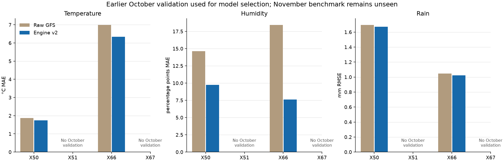
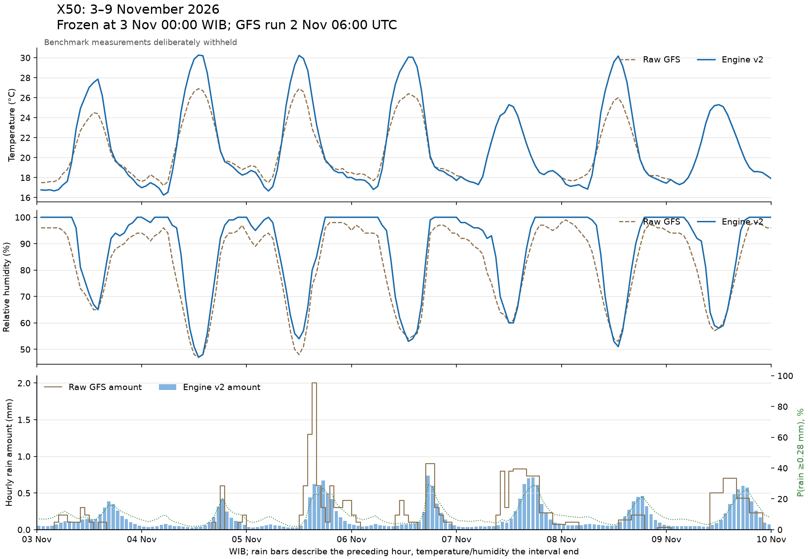
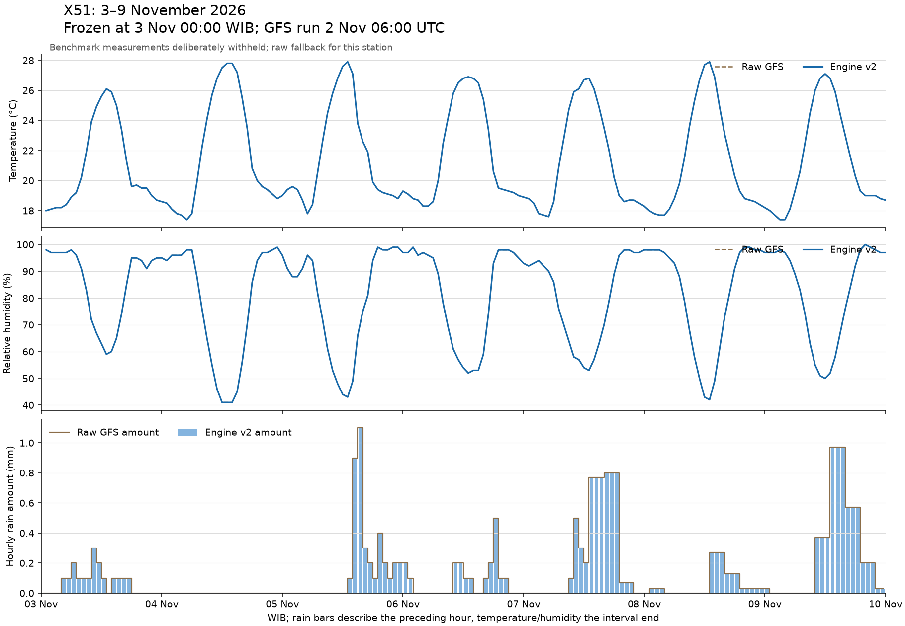
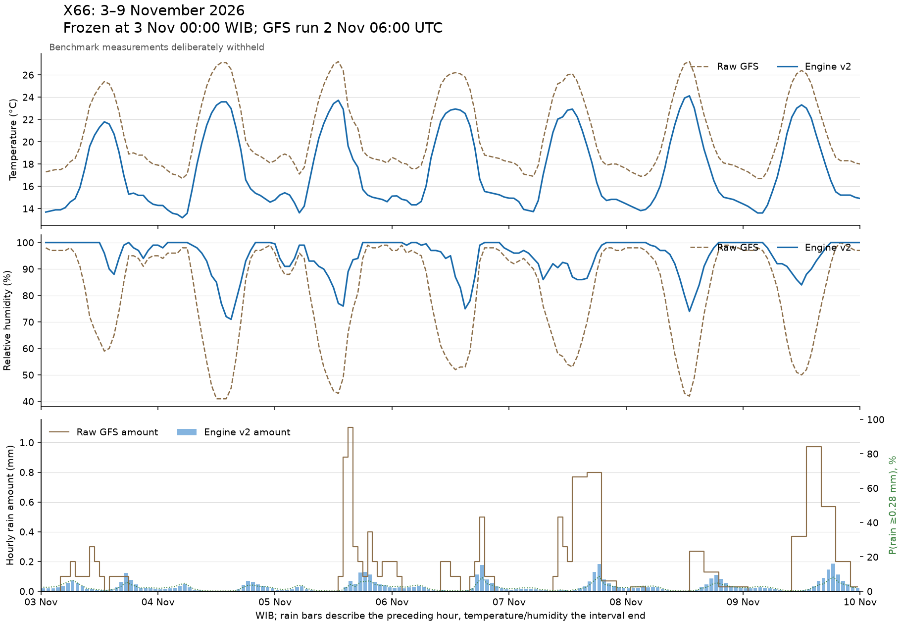
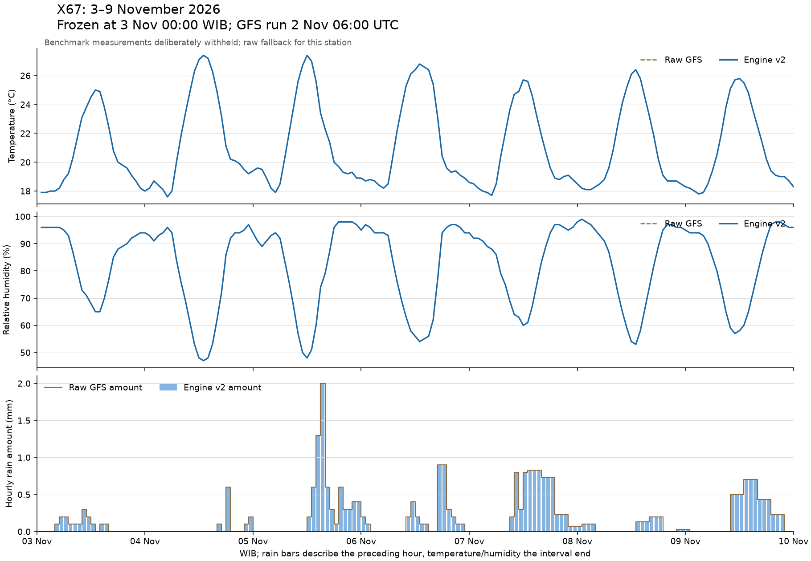

# Engine v2: frozen seven-day forecast and baseline report

**Benchmark: 3–9 November 2026, WIB. The measurements for this week are deliberately withheld. Weekly accuracy is pending; it is not zero or perfect.**

## Frozen experiment

- Training target dates: 3 November 2025–2 November 2026. Every fitted observation and its assumed arrival precedes 3 November, 00:00 WIB.
- Forecast target period: 3 November, 00:00 through 10 November, 00:00 WIB, expressed as 168 hourly intervals per location.
- Future GFS source: the single run initialized **2 November 2026, 06:00 UTC (13:00 WIB)**. No GFS initialization from 3, 4 or 5 November is used.
- Conservative availability assumption: six hours after initialization, before the simulated 3 November midnight issue. The actual historical Open-Meteo publication timestamp is not independently verified.
- This forecast is reconstructed on 5 November from an archived earlier run. It was not operationally published by our system on 3 November.
- This implementation was written fresh. It neither imports nor changes `dashboard/engine.mjs`, and does not use its 72/30 shrinkage formulas.

## Inputs and station eligibility

| Station | Accepted source readings | Latest supplied observation, WIB | Status |
| --- | ---: | --- | --- |
| X50 | 56,458 | 2026-11-02T15:00:09+07:00 | Historical measurements eligible; October validation determines corrections |
| X51 | 46,417 | 2026-08-25T14:00:10+07:00 | History stops in August; no October validation, so raw forecast fallback |
| X66 | 21,037 | 2026-11-02T15:00:08+07:00 | Historical measurements eligible; October validation determines corrections |
| X67 | 0 | Unavailable | Supplied export belongs to X66; excluded as X67 truth; raw forecast fallback |

The X67 source duplicates 21,033 X66 weather/error records and carries X66’s device ID and coordinates. It is not counted as another station. X67 still receives its own location-specific GFS forecast.

The user clarified E3=HDC1080, E8=soil temperature, E11=soil moisture and E12=leaf wetness. Those flags do not invalidate BME280 `t`/`h` or a valid rain gauge. Absent HDC/leaf fields can produce false firmware flags. This baseline uses BME280 `t`/`h` consistently and does not silently substitute SHT/HDC readings.

**X66 reference discrepancy:** October medians are t=12.02°C versus tsht=18.885°C, and h=100% versus hsht=90%. The temperature streams were much closer in June. The user explicitly chose to retain t/h and flag this discrepancy. Thus X66 scores measure agreement with that retained stream; they do not verify the physical accuracy of the station. Its large temperature error remains visible.

Temperature/humidity targets use the closest valid measurement within five minutes of the hourly instant. Rain totals require all six checked 10-minute intervals, 0.28 mm/tip consistency, no counter reset/gap and a maximum 90-second nominal-clock alignment. This clock adjustment is an explicit approximation. Missing rain coverage is not dry weather. Observation arrival is conservatively approximated as measurement time plus one hour because historical arrival timestamps were not exported.

## One-year raw GFS baseline

All four locations have 8,760 archived target hours and seven fixed day-lead series for each variable. Missing observations reduce verification coverage. The table shows the 24-hour-offset baseline across the supplied historical observations, not this week’s accuracy. Full day-1 through day-7 metrics are in `historical_gfs_accuracy.csv`.

| Station | Variable | Valid hourly pairs | MAE | RMSE | Bias, forecast − measured |
| --- | --- | ---: | ---: | ---: | ---: |
| X50 | temperature | 8,702 | 1.929 | 2.766 | -0.493 |
| X51 | temperature | 7,030 | 2.515 | 3.761 | -0.866 |
| X66 | temperature | 3,507 | 3.972 | 4.854 | 2.846 |
| X67 | temperature | 0 | Unavailable | Unavailable | Unavailable |
| X50 | humidity | 8,702 | 10.947 | 14.249 | -6.590 |
| X51 | humidity | 7,030 | 9.657 | 13.080 | -0.975 |
| X66 | humidity | 3,507 | 17.536 | 25.099 | -12.226 |
| X67 | humidity | 0 | Unavailable | Unavailable | Unavailable |
| X50 | rain | 8,650 | 0.490 | 1.935 | 0.174 |
| X51 | rain | 6,965 | 0.598 | 2.057 | 0.222 |
| X66 | rain | 3,504 | 0.131 | 0.596 | 0.075 |
| X67 | rain | 0 | Unavailable | Unavailable | Unavailable |

Units: temperature °C, humidity percentage points, rain mm per hour. GFS here means Open-Meteo’s explicit `gfs_seamless` recipe, including its elevation processing with the supplied site elevations; it is not untouched raw model-grid output.

## Earlier October validation: selecting the new model

Candidate fitting stops before 1 October. Selection uses four earlier seven-day forecasts issued on 6, 13, 20 and 27 October, with measurements available before the November cutoff. Annual fixed-day history supplies training pairs; earlier exact weekly-run cases replace matching station/target/day-band pairs rather than being counted twice. Fixed-day leads are representative of day bands, not every exact subdaily lead. The exact-run October check tests that approximation.

These scores are validation results used to choose methods. They are not an untouched final test, and the chosen models are not proven to improve November forecasts. Final fitting then uses all eligible pre-cutoff training/validation history; November observations remain unseen.

| Station | Variable | Validation pairs | Raw MAE | V2 MAE | Raw RMSE | V2 RMSE |
| --- | --- | ---: | ---: | ---: | ---: | ---: |
| X50 | temperature | 644.0 | 1.862 | 1.748 | 2.672 | 2.423 |
| X50 | humidity | 644.0 | 14.640 | 9.748 | 18.815 | 15.202 |
| X50 | rain | 624.0 | 0.391 | 0.379 | 1.696 | 1.670 |
| X51 | temperature | 0 | Unavailable | Unavailable | Unavailable | Unavailable |
| X51 | humidity | 0 | Unavailable | Unavailable | Unavailable | Unavailable |
| X51 | rain | 0 | Unavailable | Unavailable | Unavailable | Unavailable |
| X66 | temperature | 662.0 | 6.993 | 6.341 | 7.182 | 6.550 |
| X66 | humidity | 662.0 | 18.435 | 7.611 | 26.386 | 12.897 |
| X66 | rain | 661.0 | 0.333 | 0.184 | 1.045 | 1.025 |
| X67 | temperature | 0 | Unavailable | Unavailable | Unavailable | Unavailable |
| X67 | humidity | 0 | Unavailable | Unavailable | Unavailable | Unavailable |
| X67 | rain | 0 | Unavailable | Unavailable | Unavailable | Unavailable |

Temperature/humidity choose raw, a median residual, or a forecast-day/local-hour median residual using MAE. Rain compares raw, a nonnegative least-squares slope and a two-part occurrence/positive-amount model using RMSE. The latter models use regularized regression; penalties are selected from declared candidates on October data. A selected improvement in one score can worsen another; inspect wet-event errors, misses and false alarms in `validation_candidates.csv`.

Hourly rain occurrence is a separate probability model selected with Brier score against training-only climatology. Its event is **at least 0.28 mm in the forecast hour**, not Open-Meteo’s differently defined hourly probability. This baseline has no validated joint 6/12/24-hour probability model; those fields remain unavailable instead of being computed by adding hourly probabilities. Independent probability and amount candidates are not a fully coherent joint predictive distribution.

The minimum training/validation counts and hour-specific support rules are declared prototype safeguards, not established scientific sufficiency criteria. X51 and X67 have no eligible October validation and retain raw forecasts. This experiment does not establish spatial correction over 50 km.

## Forecast and baseline files

- `history/GFS_[station]_20251103_20261102.csv`: full-year GFS tables, 8,760 targets per station with all seven fixed day-lead series for temperature, humidity and rain. `gfs_archive_coverage.csv` records missing-value coverage.
- `frozen_forecasts.csv`: 672 rows, 168 per station, with raw GFS, V2, hourly rain-event probability when available and method labels.
- `daily_forecasts.csv`: seven complete local dates per station. Rain is summed; temperature/humidity are means of the 24 interval-end instantaneous forecasts.
- `forecast_windows.csv`: initial 1/6/12/24-hour rain totals with explicit endpoints.
- `models.json`, `frozen_predictions.json`, `protocol.json` and the lock manifest preserve the exact baseline for later scoring.

## Weekly benchmark status

| Station | Expected forecast hours | Supplied benchmark observations | Weekly accuracy |
| --- | ---: | ---: | --- |
| X50 | 168 | 0 | Pending blinded actuals |
| X51 | 168 | 0 | Pending blinded actuals |
| X66 | 168 | 0 | Pending blinded actuals |
| X67 | 168 | 0 | Pending blinded actuals |

When the user supplies measurements from 3 November onward, run the scoring command without rebuilding the model. It verifies frozen file hashes, aligns measured outcomes and writes separate scores and comparison plots. Partial weeks report only matched observations and coverage; future or missing hours never count as zero rainfall.

## Forecast plots

### X50

### X51

### X66

### X67

## Provenance and interpretation

The station CSVs are preserved at their original paths. The training audit and source checksums are included in the package. Open-Meteo responses are saved under the project’s `data/engine_v2/gfs` directory, including monthly fixed-lead history, earlier exact-run samples and the frozen run. No station values or model values have been invented.

The new station coordinates were supplied by the user; X50’s 1230 m elevation is estimated and other elevations are user-provided. These static metadata were used consistently in archive requests. Sensor quality checks establish consistency, not instrument calibration accuracy.

Sources: [Open-Meteo Previous Runs](https://open-meteo.com/en/docs/previous-runs-api), [Single Runs](https://open-meteo.com/en/docs/single-runs-api), [variable definitions](https://open-meteo.com/en/docs). Weather data attribution: Open-Meteo, CC BY 4.0.
