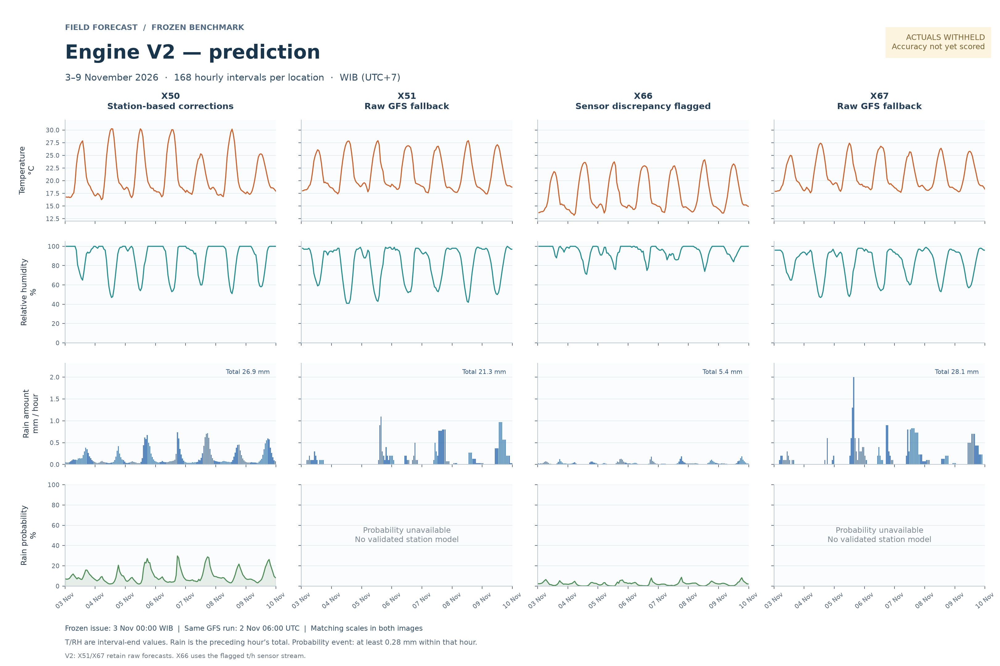
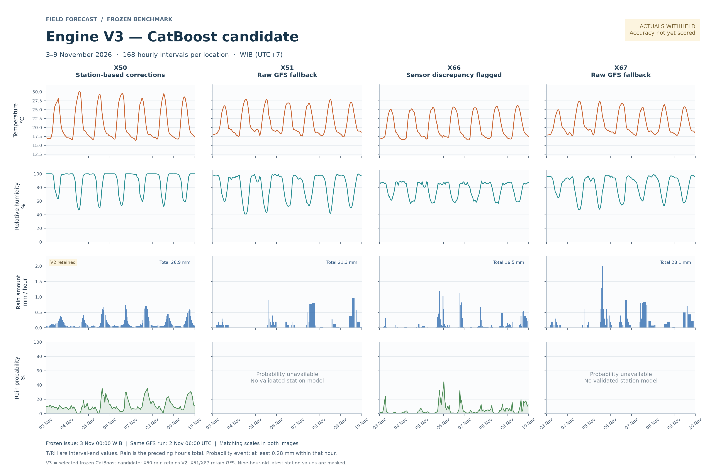

# Engine V3 — CatBoost

V3 is the name for the frozen CatBoost candidate trained beside Engine V2.
The internal artifact identifier `engine_v2_catboost.1` and benchmark folder name
are retained so the original lock and trained predictions stay byte-for-byte intact.

Three candidates are included: existing inputs/full V2 dataset, existing
inputs/exact weekly runs, and station-history features on the same exact-run rows.
October validation selects each output component. The selected forecast retains
V2 for X50 rain amount and raw GFS for X51/X67. X66 retains the sensor discrepancy.

## Predictions

Both versions cover 3–9 November 2026 in 168 hourly intervals per location, using
the same GFS run initialized on 2 November at 06:00 UTC. November measurements
were withheld when this snapshot was frozen. October results are model-selection evidence, not final accuracy.

### Original V2



### V3 — selected CatBoost candidate



The graphs share axis ranges. Rain probability means at least 0.28 mm/hour.
Joint 6/12/24-hour probabilities remain unavailable. At the frozen issue, X50/X66
station readings are about nine hours old: expired latest/rolling values are
missing, so history-model validation gains may not transfer to this context.

## Verify the published snapshot

From the repository root, with Python 3.10 or newer:

```sh
python v3/verify_package.py
```

This standard-library check verifies every original candidate-lock entry, every
original V2-lock entry and both README graphs against their recorded hashes.
It needs no raw station data, provider archives or machine-learning dependencies.

## Source and dependencies

```sh
python -m venv v3/.venv
# Activate the virtual environment for your shell, then:
python -m pip install -r v3/requirements.lock.txt
python -m unittest discover -s v3/tests -v
```

`run.py` and `weather_catboost/` preserve the training/verification/scoring workflow.
Its full audit reads the original raw forecast and normalized-observation inputs
and recorded workspace paths. Those private/local inputs are not included here;
the portable hash check above is the fresh-clone verification entry point.
Building a new experiment requires restoring the V2 inputs under its version root
and selecting a different `--output`; never rebuild the locked benchmark.

## Artifacts

- [Training report](output/benchmark_20261103_catboost/training_report.md)
- [Frozen hourly predictions](output/benchmark_20261103_catboost/frozen_forecasts.csv)
- [Selected methods](output/benchmark_20261103_catboost/selection.json)
- [Final trained models](output/benchmark_20261103_catboost/models/final/)
- [Frozen package ZIP](output/engine_v2_catboost_frozen_benchmark_20261103.zip)
- [Original lock](output/benchmark_20261103_catboost/candidate_lock.json)

The frozen report/source/receipt retain historical local paths and notes written
before publication, including the then-current statement that nothing had been
pushed to GitHub. They are archived evidence. This README describes the published
V3 snapshot. Raw station exports, runtime environments and download caches are excluded.
