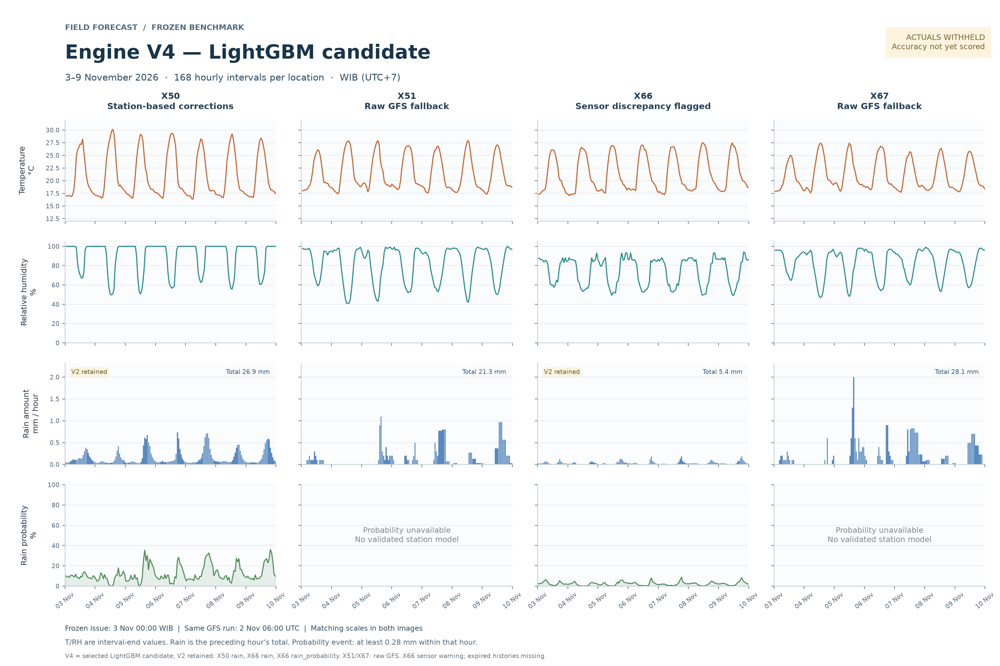

# Engine V4 — LightGBM

V4 uses V2's archived GFS and station dataset, and V3's experiment design/features.
Its LightGBM models are trained independently. V3's saved predictions are used only
as a comparison, never as training targets or predictor features. V2/V3 stay frozen.
This folder publishes the sealed V4 snapshot without retraining or changing V2/V3.

Three variants use the same training rows as their V3 counterparts: existing
inputs/full V2 dataset, existing inputs/exact weekly runs, and station-history
features/exact weekly runs. Feature definitions and initial contexts are identical.
LightGBM uses one fixed, modest CPU configuration: 400 rounds, depth 4, 15 leaves,
learning rate 0.04, L2 10 and at least 50 rows per leaf. No tuning or early stopping.

Validation fitting ends before 1 October; four October weekly forecasts select
methods. Final fitting uses only labels/assumed arrivals before 3 November midnight
WIB. The forecast uses the same 2 November 06 UTC GFS run as V2/V3 for 3–9 November.
October results are selection evidence, not an untouched test. November observations
were withheld when this snapshot was frozen. V4 may retain V2 or raw forecasts for a component where LightGBM
does not improve the declared metric. V3 is excluded from V4 component selection.

## Verify the published snapshot

From the repository root, with the Python standard library:

```sh
python v4/verify_package.py
```

This verifies V4, V3 and V2 frozen files and all three comparison graph hashes.
It requires no private inputs or machine-learning dependencies.

## Install and test

```sh
python -m venv v4/.venv
# Activate the environment for your shell, then:
python -m pip install -r v4/requirements.lock.txt
python -m unittest discover -s v4/tests -v
```

## Original research workflow

The original workflow below requires the private/local training inputs and
recorded workspace paths. The portable fresh-clone check is verify_package.py.
The sealed output cannot be rebuilt; new experiments require a different output.

```powershell
$v4Python = './v4/.venv/Scripts/python.exe'
& $v4Python -m unittest discover -s v4/tests -v
& $v4Python v4/run.py build
& $v4Python v4/run.py verify
& $v4Python v4/run.py lock
```

The output is `v4/output/benchmark_20261103_lightgbm/`. Build needs the
existing V2 raw archive and normalized observations, plus V3's locked experiment.
Each new experiment needs its own empty output directory; a locked candidate
cannot be overwritten. Later `score --source-root PATH` verifies locks and uses
new measurements only for scoring, never for refitting.

Missing station histories are explicit. At the frozen issue, X50/X66 readings are
about nine hours old, so the inherited six-hour expiry masks latest/rolling values.
X66 retains its t/h discrepancy; X51/X67 lack October support and retain raw GFS.
Hourly rain event is >=0.28 mm. Joint 6/12/24-hour probabilities remain unavailable.

Before locking, generate the shared-scale V2/V3/V4 graphs:

```powershell
& $v4Python v4/make_graphs.py
```

The graph renderer refuses to overwrite a locked experiment. The resulting
`graphs/V4_prediction_7days.png` uses the selected V4 components, with retained
V2/raw components identified. Graphs and source are included in the candidate lock.

## Prediction comparison



V4 retains V2 for X50/X66 rain amounts and X66 rain probability. X51/X67 use raw
GFS. The images use the same GFS run, forecast intervals and axis ranges as V2/V3.
October scores select methods; These saved forecasts retain their original pre-evaluation state.

- [Training report](output/benchmark_20261103_lightgbm/training_report.md)
- [Validation comparison graph](output/benchmark_20261103_lightgbm/validation.png)
- [Frozen predictions](output/benchmark_20261103_lightgbm/frozen_forecasts.csv)
- [Final trained models](output/benchmark_20261103_lightgbm/models/final/)
- [Selected methods](output/benchmark_20261103_lightgbm/selection.json)
- [Candidate lock](output/benchmark_20261103_lightgbm/candidate_lock.json)

The frozen report/source retain original paths and pre-publication notes,
including then-current no-push statements. Those historical records are copied
unchanged; this README describes the published snapshot. Environments, caches,
raw provider responses and raw station exports are excluded.
