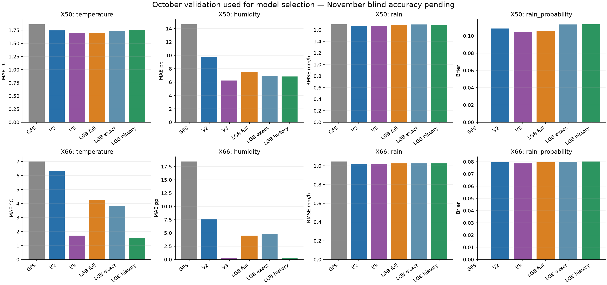
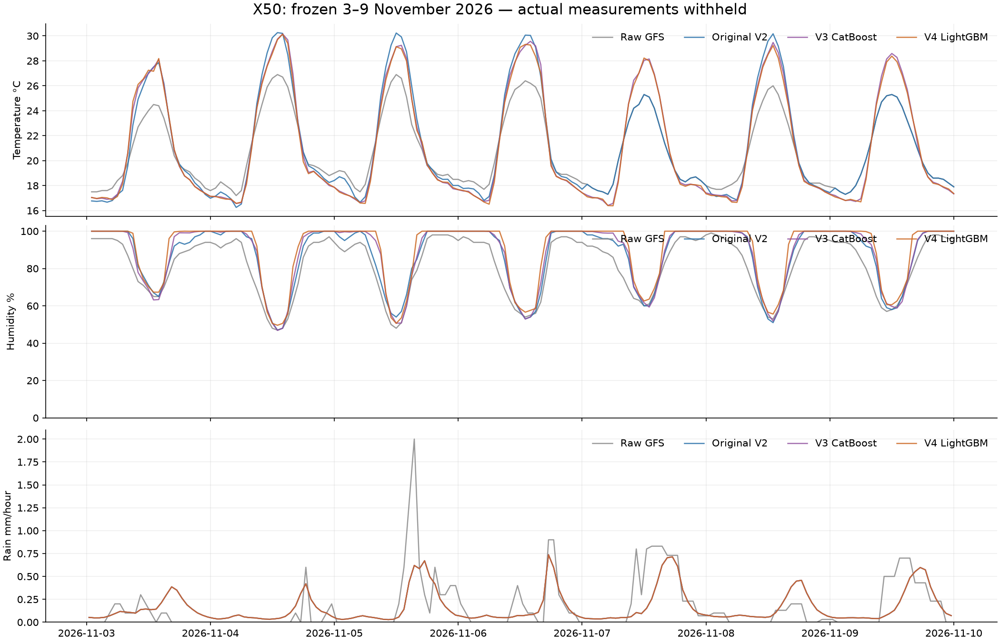
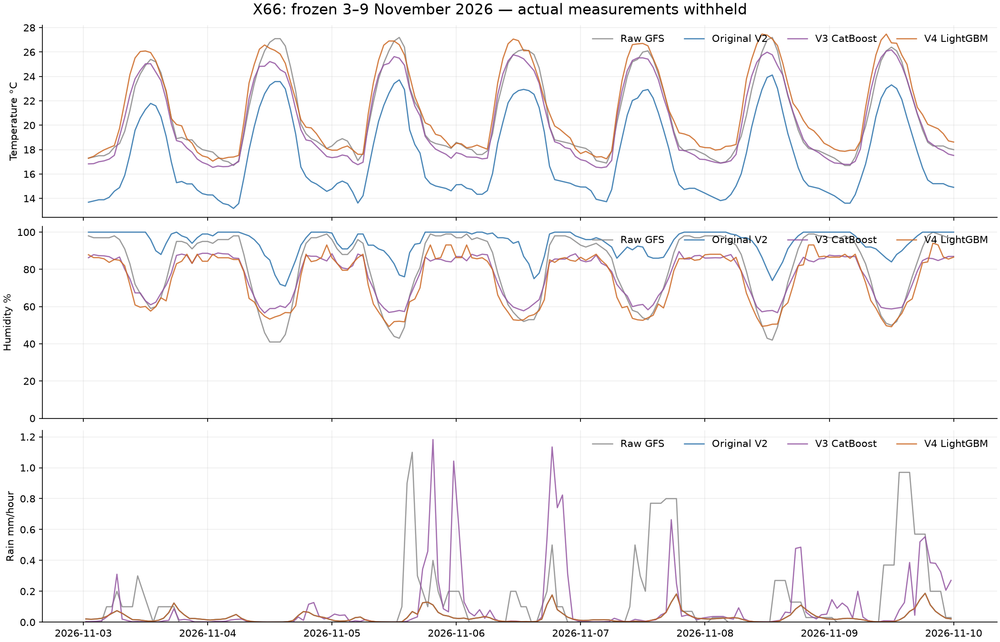
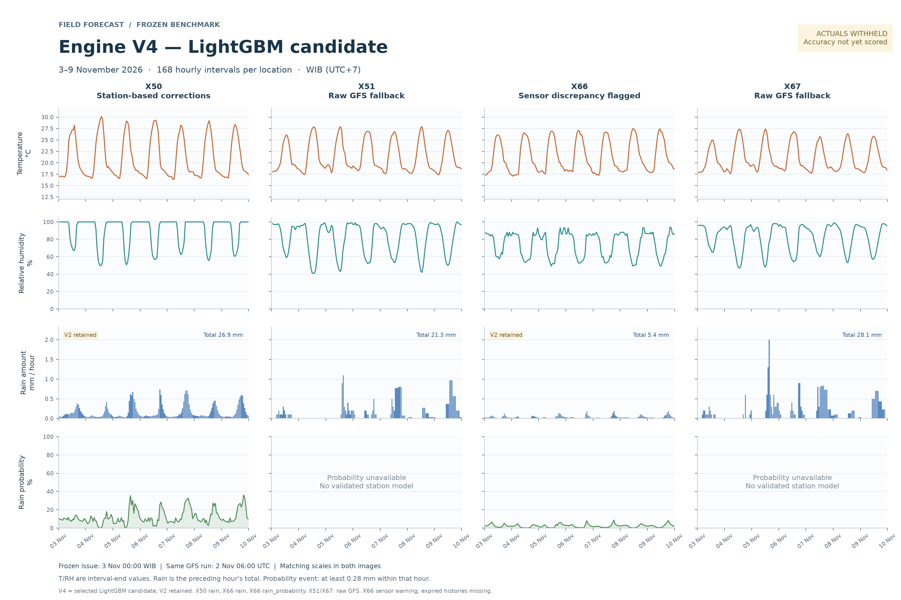

# Engine V4: independent LightGBM candidate

**The original V2 and V3 are unchanged. All November benchmark actuals remain withheld.**

Three LightGBM candidates were trained and their predictions saved for 3–9 November 2026. The selected forecast uses the best October method per station/component, including original V2 or raw fallback when a LightGBM candidate did not improve the declared metric.

## Data and experiment

- Temperature/humidity: regress observation minus GFS with MAE loss. Humidity is bounded to 0–100%.
- Rain: Logloss occurrence classifier plus RMSE positive-amount regressor; expected amount is their product.
- Fixed LightGBM configuration: 400 rounds, depth 4, 15 leaves, at least 50 rows/leaf, learning rate 0.04, L2 10, deterministic CPU/fixed seed. No hyperparameter search or early stopping.
- Same V2 data and V3 feature/experiment design. LightGBM is trained independently, without CatBoost weights or CatBoost predictions as inputs.
- Saved V3 validation predictions are matched by station, issue and target. Its selected output is a comparator only; V4 cannot select a V3 component.
- `lightgbm_base_full`: existing annual V2 pairs, preferring matching exact weekly runs.
- `lightgbm_base_exact`: exact weekly forecasts only, using the same six existing-input features.
- `lightgbm_history_exact`: same exact training rows plus then-available station history and recent forecast errors.
- The exact-only comparison isolates added history features. Comparing history against base_full also changes the training dataset.
- Fit for validation: all labels and assumed arrivals before 1 October. Evaluate four exact October weekly forecasts.
- Select component methods using October MAE (temperature/humidity), RMSE (rain), Brier score (probability).
- Refit all supported LightGBM variants using only labels/arrivals before 3 November 00:00 WIB.
- Frozen future GFS: the same 2 November 06 UTC run as V2. No GFS updates from 3 November onward.
- One fixed station context at the simulated issue is used for all 168 hours. No later actual is fed into later hours.

## October validation comparison

These are **model-selection results, not untouched final-test accuracy**. Original V2 recipes were selected on October in the earlier experiment; their parameters are refitted on pre-October data here. Final November-trained V2 parameters are never evaluated against October outcomes. All compared methods use identical valid cases per variable. Overlapping forecast errors and repeated targets across lead bands are correlated; row counts are not independent storm counts.

| Station | Variable | Matched hours | Raw GFS | Original V2 recipe | V3 selected | LightGBM full | LightGBM exact | LightGBM + history | Selected |
| --- | --- | ---: | ---: | ---: | ---: | ---: | ---: | ---: | --- |
| X50 | temperature | 644 | 1.862 | 1.748 | 1.704 | 1.696 | 1.743 | 1.752 | lightgbm_base_full |
| X50 | humidity | 644 | 14.640 | 9.748 | 6.219 | 7.507 | 6.917 | 6.831 | lightgbm_history_exact |
| X50 | rain | 624 | 1.696 | 1.670 | 1.670 | 1.689 | 1.694 | 1.680 | engine_v2 |
| X50 | rain_probability | 624 | — | 0.1086 | 0.1047 | 0.1056 | 0.1130 | 0.1133 | lightgbm_base_full |
| X51 | temperature | 0 | — | — | — | — | — | — | raw_gfs |
| X51 | humidity | 0 | — | — | — | — | — | — | raw_gfs |
| X51 | rain | 0 | — | — | — | — | — | — | raw_gfs |
| X51 | rain_probability | 0 | — | — | — | — | — | — | unavailable |
| X66 | temperature | 662 | 6.993 | 6.341 | 1.709 | 4.272 | 3.843 | 1.558 | lightgbm_history_exact |
| X66 | humidity | 662 | 18.435 | 7.611 | 0.289 | 4.492 | 4.874 | 0.212 | lightgbm_history_exact |
| X66 | rain | 661 | 1.045 | 1.025 | 1.023 | 1.026 | 1.026 | 1.026 | engine_v2 |
| X66 | rain_probability | 661 | — | 0.0795 | 0.0786 | 0.0796 | 0.0801 | 0.0801 | engine_v2 |
| X67 | temperature | 0 | — | — | — | — | — | — | raw_gfs |
| X67 | humidity | 0 | — | — | — | — | — | — | raw_gfs |
| X67 | rain | 0 | — | — | — | — | — | — | raw_gfs |
| X67 | rain_probability | 0 | — | — | — | — | — | — | unavailable |

Temperature is MAE in °C; humidity MAE in percentage points; rain RMSE in mm/hour; probability is Brier score. Lower is better. Raw GFS probability is unavailable because the archived input contains no matching event probability.

## First 24 hours of the October forecasts

This subset is reported separately; selections above use the full seven-day validation period.

| Station | Variable | Hours | Raw GFS | Original V2 | V3 selected | LightGBM full | LightGBM exact | LightGBM + history |
| --- | --- | ---: | ---: | ---: | ---: | ---: | ---: | ---: |
| X50 | temperature | 96 | 1.844 | 1.699 | 1.612 | 1.613 | 1.700 | 1.754 |
| X50 | humidity | 96 | 12.448 | 8.000 | 5.149 | 5.970 | 4.844 | 4.841 |
| X50 | rain | 96 | 0.299 | 0.289 | 0.289 | 0.432 | 0.272 | 0.394 |
| X50 | rain_probability | 96 | — | 0.0336 | 0.0323 | 0.0326 | 0.0256 | 0.0299 |
| X66 | temperature | 95 | 7.130 | 6.460 | 1.414 | 4.082 | 3.357 | 1.310 |
| X66 | humidity | 95 | 22.011 | 10.026 | 0.533 | 3.867 | 4.188 | 0.407 |
| X66 | rain | 94 | 0.374 | 0.153 | 0.155 | 0.156 | 0.155 | 0.155 |
| X66 | rain_probability | 94 | — | 0.0203 | 0.0219 | 0.0212 | 0.0208 | 0.0207 |

## Rain amount diagnostics

A small RMSE improvement is not evidence that rain timing or totals are solved. In particular, the X66 models substantially underpredict October rain. Hits below count hours whose expected amount reaches 0.28 mm, not probability-based event decisions.

| Station | Method | Observed total mm | Expected total mm | Amount MAE | Wet-hour MAE | Hits | Misses | False alarms |
| --- | --- | ---: | ---: | ---: | ---: | ---: | ---: | ---: |
| X50 | raw_gfs | 180.040 | 106.800 | 0.391 | 2.000 | 33 | 50 | 92 |
| X50 | engine_v2 | 180.040 | 97.138 | 0.379 | 1.942 | 29 | 54 | 83 |
| X50 | engine_v3 | 180.040 | 97.138 | 0.379 | 1.942 | 29 | 54 | 83 |
| X50 | lightgbm_base_full | 180.040 | 117.811 | 0.406 | 1.927 | 33 | 50 | 101 |
| X50 | lightgbm_base_exact | 180.040 | 54.234 | 0.331 | 2.016 | 19 | 64 | 36 |
| X50 | lightgbm_history_exact | 180.040 | 67.858 | 0.344 | 1.994 | 24 | 59 | 52 |
| X66 | raw_gfs | 117.600 | 139.800 | 0.333 | 1.929 | 25 | 30 | 139 |
| X66 | engine_v2 | 117.600 | 6.286 | 0.184 | 2.119 | 0 | 55 | 0 |
| X66 | engine_v3 | 117.600 | 7.939 | 0.186 | 2.113 | 1 | 54 | 1 |
| X66 | lightgbm_base_full | 117.600 | 5.557 | 0.184 | 2.122 | 0 | 55 | 0 |
| X66 | lightgbm_base_exact | 117.600 | 5.980 | 0.184 | 2.123 | 0 | 55 | 0 |
| X66 | lightgbm_history_exact | 117.600 | 3.953 | 0.182 | 2.126 | 0 | 55 | 0 |

## Final training sample counts

| Station | Variable | Full paired rows | Exact-only paired rows | Full unique target hours |
| --- | --- | ---: | ---: | ---: |
| X50 | temperature | 60914 | 4994 | 8702 |
| X50 | humidity | 60914 | 4994 | 8702 |
| X50 | rain | 60550 | 4955 | 8650 |
| X66 | temperature | 24549 | 3507 | 3507 |
| X66 | humidity | 24549 | 3507 | 3507 |
| X66 | rain | 24528 | 3504 | 3504 |

## Station history at the frozen issue

The supplied exports end around 2 November 15:00 WIB. At the simulated 3 November midnight issue, X50/X66 readings are about nine hours old. Latest/rolling station values therefore expire under the declared six-hour feature rule and remain missing. Ages and then-available 24-hour error features are still provided. The history model accepts missing features, but its October validation advantage may not carry over to this less recent context. All variant forecasts are retained for the blind comparison.

| Station | Temperature age (hours) | Humidity age (hours) | Rain age (hours) | Latest readings usable |
| --- | ---: | ---: | ---: | --- |
| X50 | 9.00 | 9.00 | 15.00 | None |
| X51 | 1666.00 | 1666.00 | 1666.00 | None |
| X66 | 9.00 | 9.00 | 9.00 | None |
| X67 | — | — | — | None |

## Boundaries and known issues

- X51 has no October validation; X67 has no accepted independent observations. They retain raw GFS with unavailable fitted rain probabilities.
- X66 uses the user-retained t/h sensor stream despite its disagreement with tsht/hsht. Lower error against that stream does not establish physical sensor accuracy.
- Station receipt times remain an assumption of measurement plus one hour. Feature use is audited against that assumed availability, not verified historical receipts.
- Raw input source hashes, normalized observation hashes, training cutoffs and all feature availability maxima are recorded.
- Annual day-band forecasts are approximate lead representatives. History features are never attached to those rows because exact issue times are unknown.
- Exact weekly simulations all issue at midnight WIB. Generalization to arbitrary hourly updates is untested.
- Hourly rain means >=0.28 mm. Joint 6/12/24-hour probabilities remain unavailable. Amount/probability selections may differ, so the selected output is not a full joint predictive distribution.
- The experiment is retrospective and the original GFS publication timestamp is unverified. Transfer to sites 50 km away is unproven.
- No model has been uploaded to GitHub.

## Artifacts

- `frozen_forecasts.csv` / `frozen_predictions.json`: all 672 original/raw/candidate/selected hourly forecasts.
- `models/final/`: saved LightGBM models and feature definitions for both eligible stations and all three variants.
- `selection.json`: chosen components and October selection scores.
- `forecast_windows.csv`: initial 1/6/12/24-hour rain totals; `daily_forecasts.csv`: seven daily summaries.
- `validation_scores.csv`: identical-case scores for all horizons and each day/first 24h.
- `validation_predictions.csv`: row-level October observations and predictions.
- `training_audit.json`, `feature_availability.csv`, `frozen_features.json`, `input_checksums.json`: leakage/provenance audit.
- `candidate_lock.json`: immutable hashes after review; later scoring writes separate output and never refits.

Runtime: Python 3.12.14; lightgbm 4.7.0, numpy 2.5.4, pandas 3.1.1, scipy 1.18.1, matplotlib 3.11.2.

Official implementation references: [LightGBM parameters](https://lightgbm.readthedocs.io/en/stable/Parameters.html), [tuning guidance](https://lightgbm.readthedocs.io/en/stable/Parameters-Tuning.html).

## Frozen forecast comparisons

## V4 prediction graph

The graphs use matching scales across V2, V3 and V4. V4 labels retained V2 components.

[V2 graph](graphs/V2_prediction_7days.png) · [V3 graph](graphs/V3_prediction_7days.png)
