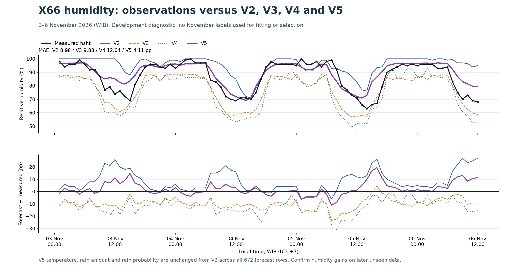

# Engine V5: humidity improvement

V5 keeps **V2 temperature, rainfall amount and rain probability exactly unchanged**.
Only humidity can change. The first supported station is X66, which has independent
historical `hsht` readings from June through 2 November 2026. Other stations retain
their V2 humidity output until equivalent training/validation evidence exists.

The humidity target is `hsht`, not `h`. V5 combines V2's humidity baseline with
new humidity-only CatBoost and LightGBM learners based on V3/V4's residual-model
designs. These new learners are trained against SHT humidity; the old V3/V4 models
and their predictions remain frozen. Forecast inputs are GFS temperature/humidity/
rain, local hour and lead day, plus then-available SHT humidity history/errors.

Two later October weekly forecasts evaluate eight small candidate combinations.
Learned weights use only earlier available October outcomes. A humidity update must
beat V2's development MAE by at least 0.5 percentage points to activate. Final
humidity fits use only labels/assumed arrivals before 3 November 00:00 WIB. No
November measurements are used to fit or select the candidate.

The 3–6 November outcomes have already been discussed, so that comparison is a
development diagnostic. Confirmation requires later observations unseen when V5
is sealed. Historical forecast publication/receipt timings remain assumptions.

## Current result

October development validation selected an equal-third blend of V2 humidity,
the new CatBoost hsht component and the new LightGBM hsht component. These are
fixed equal weights selected by validation, rather than fitted stack weights.
Both tree components were finally trained on 3,507 pre-cutoff humidity examples.

| Comparison | V2 humidity MAE, pp | V5 humidity MAE, pp |
| --- | ---: | ---: |
| Two later October weekly forecasts, 326 cases | 7.282 | 6.739 |
| Previously revealed 3–6 November period, 84 cases | 8.982 | 4.111 |

On the November development comparison, V5 humidity RMSE is 5.903 pp versus
V2's 11.850 pp. The new CatBoost component alone scored 3.314 pp MAE on that
same November sample. The selected V5 blend stays as chosen on October;
November outcomes do not trigger another round of model selection.

All 672 temperature, rainfall-amount and rain-probability values match V2
bit for bit. Ten V5 tests pass, and all 280 old locked files plus 35 V5 locked
files verify. The new humidity update applies to X66; other stations retain V2.



Read the [development training report](output/benchmark_20261103_humidity_v5/training_report.md),
[November comparison](output/evaluation_20261106/report.md),
[chosen combination](output/benchmark_20261103_humidity_v5/selection.json),
and [independent verification](output/evaluation_20261106/independent_verification.json).

## Verify the published models and results

From the repository root, using Python 3.10 or newer and no external dependencies:

```sh
python v5/verify_package.py
```

This checks the published V5 files, all 35 V5 and 280 V2/V3/V4 locked files,
all 672 unchanged temperature/rain/probability rows, the selected humidity blend,
and the reported October/November metrics. No training CSV or ML runtime is needed.

The [final trained CatBoost and LightGBM models](output/benchmark_20261103_humidity_v5/models/final/)
and [ensemble parameters](output/benchmark_20261103_humidity_v5/selection.json)
are included. The [publication record](publication.json) fingerprints this snapshot.
Frozen source/audit files preserve their original local paths and pre-publication
statements. The November evaluation report is updated to describe publication.

## Original local research workflow

The original training workspace has separate CatBoost and LightGBM environments.
The driver reuses those interpreters without changing them; explicit interpreter
paths can be supplied. A single environment with both packages also works.

```sh
# Use the Python environment containing NumPy, SciPy and matplotlib.
python -m unittest discover -s v5/tests -v
python v5/run.py build
python v5/run.py verify
python v5/run.py score --actuals C:/path/to/new-X66.csv
```

Never rebuild a locked output. New experiments require a different `--output`.
Training reads the existing local raw station/GFS archives; those private inputs
are not silently replaced by later station exports. Source hashes, availability
audits, learned weights, predictions and original-reference checks are recorded.
The frozen source archive retains the exact build-time README; this entry-point
README adds the subsequent evaluation results.

## Version boundaries

- V2/V3/V4 stay frozen; V5 is a separate top-level folder.
- V5 does not train temperature or rain models, and does not use `sm`/`srm`.
- V6 is reserved for rainfall work and comparison with `sm`/`srm`.
- This snapshot is published on `main` under the top-level `v5/` folder.
  Training/scoring commands do not publish changes; version work stays on `main`.
