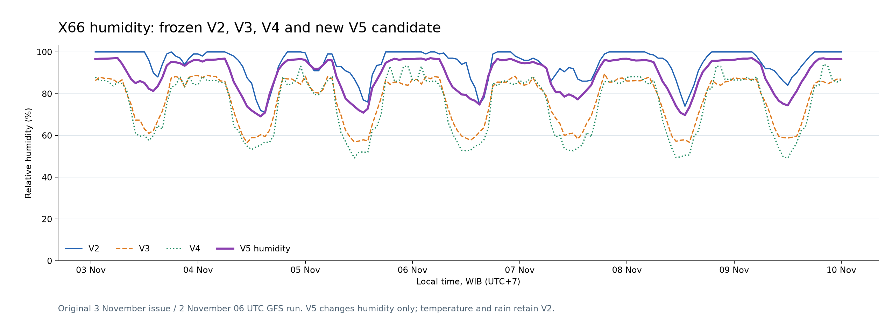

# V5 humidity development experiment

**Temperature, rainfall amount and rain probability are exact V2 passthroughs for all 672 forecast rows.**

V5 combines V2 humidity with humidity-only CatBoost and LightGBM learners based on V3/V4 designs. Both new learners target `hsht` residuals against GFS. The original V2/V3/V4 models remain unchanged.

X66 has 2723 pre-October exact-run training rows, 662 October calibration/validation cases and 3507 final pre-November training rows. Latest/rolling SHT history expires after six hours. The frozen issue has older readings, so expired values remain missing.

## Later-October development results

Base learner validation fits use labels/assumed arrivals before 1 October. Ensemble weights at the 20 and 27 October issues use only earlier available labels. These later-week results select the combination; they are not an untouched final test. V2 method recipes had also been selected on October in earlier work.

| Family | Cases | MAE pp | RMSE pp | Bias pp |
| --- | ---: | ---: | ---: | ---: |
| v2 | 326 | 7.282 | 11.923 | +6.298 |
| catboost_hsht | 326 | 8.016 | 10.617 | -3.618 |
| lightgbm_hsht | 326 | 8.443 | 11.163 | -3.999 |
| equal_three | 326 | 6.739 | 9.577 | -0.440 |
| equal_trees | 326 | 8.208 | 10.871 | -3.809 |
| v2_bias | 326 | 7.601 | 10.106 | +0.419 |
| convex | 326 | 7.590 | 10.230 | -2.854 |
| convex_bias | 326 | 7.653 | 10.140 | -2.894 |

Selected family: **equal_three**. Best-family MAE improvement over V2: **0.543 pp**. A replacement needs at least 0.5 pp improvement; otherwise V5 retains V2 humidity.

Final combination after fitting its parameters to all eligible October out-of-time base predictions:

```json
{
  "family": "equal_three",
  "components": [
    "v2_h",
    "catboost_hsht_h",
    "lightgbm_hsht_h"
  ],
  "weights": [
    0.3333333333333333,
    0.3333333333333333,
    0.3333333333333333
  ],
  "bias_pp": 0,
  "training_rows": 662
}
```

A component may receive zero weight if calibration does not support it. Each learned convex combination has nonnegative weights summing to one; an optional global humidity offset is fitted only on earlier calibration outcomes. Final humidity is clipped to [0,100].

## Frozen X66 humidity forecast



## Evaluation boundaries

- X50/X51 have no historical hsht column. X67 has no accepted independent pre-cutoff history. Their V5 humidity remains V2 with explicit support status.
- No November labels are used to fit learners, ensemble weights or select the family.
- The November outcomes already discussed in chat make a later 3–6 November comparison a development diagnostic. Confirmation needs later observations unseen when this candidate is sealed.
- Historical GFS publication and measurement-plus-one-hour receipt timings remain assumptions.
- No temperature or rainfall learners are fitted. No sm/srm features are enabled; rainfall work is reserved for V6.
- No GitHub publication is performed.

Audits: [training](training_audit.json), [ensemble calibration](ensemble_calibration_audit.json), [feature availability](feature_availability.json), [station support](station_support.json), [selection](selection.json), [original reference locks](reference_locks.json).
