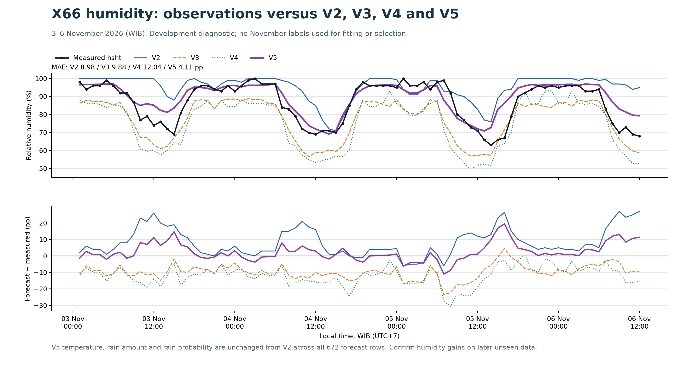

# V5: X66 humidity development comparison

**This is a post-development comparison with previously revealed November observations, not an untouched blind test.**

Humidity reference: `hsht`. Temperature, rainfall and rain probability remain exactly the frozen V2 outputs. No November observations entered humidity fitting, ensemble calibration or family selection.

| Model | Matched hours | MAE pp | RMSE pp | Bias pp | Correlation |
| --- | ---: | ---: | ---: | ---: | ---: |
| V2 | 84 | 8.982 | 11.850 | +8.315 | 0.659 |
| V3 | 84 | 9.877 | 10.759 | -9.766 | 0.920 |
| V4 | 84 | 12.044 | 13.398 | -12.017 | 0.908 |
| V5 | 84 | 4.111 | 5.903 | +2.475 | 0.889 |
| CatBoost_hsht | 84 | 3.314 | 4.707 | -0.160 | 0.909 |
| LightGBM_hsht | 84 | 4.108 | 5.416 | -0.729 | 0.880 |

V5 MAE change relative to V2: **+4.871 pp improvement**. A negative value means V5 is worse. This sample does not establish performance across other seasons or stations.

The new CatBoost/LightGBM component rows are trained within V5 against hsht. V3/V4 rows remain the original frozen versions.

Source period: 2026-11-03T00:00:08+07:00 through 2026-11-06T12:00:08+07:00. Hourly targets use the nearest valid SHT reading within five minutes, with no filling of missing observations.

The candidate was sealed before this scoring command opened the supplied export. Earlier outcomes had already been discussed in chat. The prospective confirmation boundary is recorded with the frozen predictions; observations after that boundary can provide a separate later check.

The analysis was completed locally before publication. Original JSON audit fields retain their pre-publication no-push state; this snapshot publishes the models and results without retraining. All original and V5 immutable file hashes verify after scoring.
