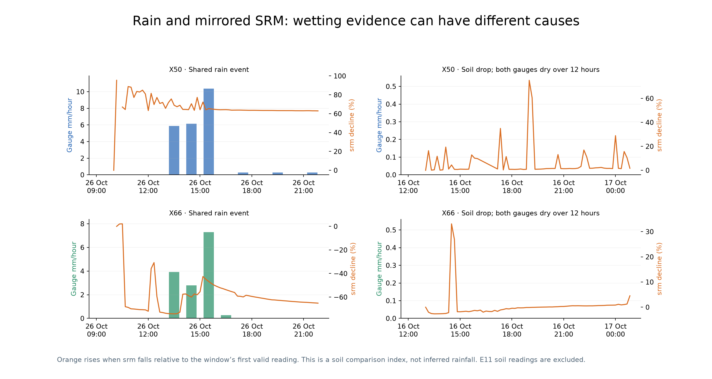
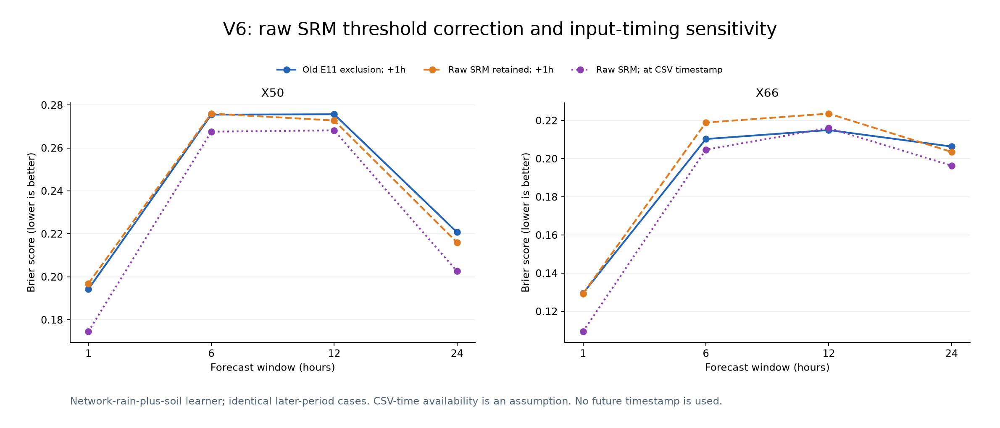

# Engine V6: rainfall and soil-response research

V6 investigates 1/6/12/24-hour rainfall forecasts using the supplied X50 and X66
exports from 6 August through 6 November 2026. Temperature and humidity retain
V5 unchanged. This research snapshot is published on `main` under the separate
top-level `v6/` folder. Earlier versions remain unchanged.

## Published package

Verify models, file hashes, protected V5 outputs and reported metrics offline with
Python 3.10 or newer; no station CSV, ML runtime or network connection is needed:

```sh
python v6/verify_package.py
```

The [publication manifest](publication.json) fingerprints this snapshot.
Raw station exports and provider-response archives remain local, as in earlier
versions. Rebuilding needs those original inputs and the pinned ML dependencies.
Initial, weekly-refresh and E11-corrected experiments are separate preserved
artifacts. Their old reports describe the policy in use when each was created.





## Current findings

**V6 remains experimental. Rainfall amount is not consistently more accurate than
raw GFS.** Nearby recent gauge rain is the more consistent occurrence signal;
adding every soil feature has not shown a reliable extra gain.

After the user's E11 clarification, a separate candidate retains finite positive
raw `srm` under that threshold flag while leaving unavailable `sm` missing. This
restores 143 X66 readings; all 29 X50 E11 rows lack raw `srm`, so they remain
missing. The approximate 7000 threshold is not hard-coded. In these exports,
X66's flagged values are 3484–4996, and unflagged values also occur below 7000.

The CSV has assigned Unix timestamps and their equivalent WIB display, but no
separate arrival timestamp. It does not establish whether the assigned time is
device measurement time or server receipt time. The previous one-hour delay was
an assumption. A new comparison holds the same targets, cases, model routing and
settings fixed while testing features available at CSV time or one hour later.
Neither replay uses future timestamps. CSV-time availability is a sensitivity,
not a confirmed live delivery configuration.

With the conservative one-hour assumption unchanged, restoring raw `srm` improves
the network-rain-plus-soil Brier score in 4/8 groups and selected amount RMSE in
1/8 groups (four ties). It does not establish a consistent accuracy gain. Using
CSV-time availability improves the same learner's Brier score in 7/8 groups
relative to the old exclusion experiment, subject to that timing assumption.
These overlapping forecast groups are not independent storms or a blind test.
Selected amount RMSE beats raw GFS in 0/8 groups under the corrected one-hour
assumption and 1/8 under CSV-time availability; neither supports broad promotion.

Read the [E11 and timestamp comparison](output/e11_corrected_20261106/report.md),
[comparison graph](output/e11_corrected_20261106/rain_probability_e11_timing.png),
and [comparison table](output/e11_corrected_20261106/comparison.csv).
The [independent verification](output/e11_correction_independent_verification_20261106.json)
checks all 160 metric rows, identical targets/cases, declared timing cutoffs and
the hashes of all 431 prior locked files plus 104 new locked files.
The corrected final models, retaining the conservative delay assumption, are in
`output/e11_corrected_20261106/raw_srm_1h/models/final/`. The CSV-time models are
separate sensitivity fits. All prior frozen outputs are preserved.

## Earlier experiments

| Later-period comparison | Original fit | Weekly-refresh follow-up |
| --- | ---: | ---: |
| Selected V6 amount RMSE lower than past-only V2 recipe | 5/8 groups | 3/8 groups |
| Selected V6 amount RMSE lower than raw GFS | 1/8 groups | 0/8 groups |
| Nearby-rain learner Brier lower than weather-only learner | 8/8 groups | 8/8 groups |
| Adding both soil streams improves nearby-rain learner Brier | 0/8 groups | 3/8 groups |

Groups are two stations × four forecast windows, not independent storms. Both
evaluations are retrospective development checks. The weekly schedule was tried
after inspecting the first results, with the original routing/settings unchanged.

With the corrected raw-SRM handling, srm decreased within an hour in 53/65 X50
and 33/41 X66 eligible rain-onset examples. The earlier strict-E11 analysis had
29/35 eligible X66 examples. It also found 391 X50 and 96 X66 hourly cases with
a drop of at least 5% while neither checked gauge reported rain nearby. These
are unconfirmed wetting cases; the data alone cannot label their causes.

The earlier experiments excluded all soil signals under E11. Those models and
reports remain unchanged as historical comparisons; the separate corrected
candidate above uses the user-described threshold interpretation.

Read the [balanced findings and control comparison](output/review_20261106/review.md),
[original model report](output/rainfall_candidate_20261106/report.md),
[three-month pattern graph](output/rainfall_candidate_20261106/rain_soil_patterns_3months.png),
[rain/mirrored-SRM examples](output/review_20261106/wetting_examples.png),
and [independent numerical checks](output/review_20261106/independent_verification.json).

The initial selected final rainfall models are preserved in
`output/rainfall_candidate_20261106/models/final/`. All 315 earlier-version locked
files, 64 initial V6 files and 52 weekly-follow-up files verify unchanged. The 672
V5 temperature/humidity rows retain their exact values. All 18 V6 tests pass.
The source, trained models and results are published together. Locked reports
and source snapshots retain historical pre-publication statements and paths.

The two stations are approximately 3.56 km apart. Their rainfall and soil signals
provide complementary inputs; each target keeps its own independent gauge labels.
Rain and manual fertigation may both reduce `srm`. Soil drops are evidence of
wetting, not confirmed rain or a measured rainfall amount.

V6 compares five fixed LightGBM hurdle designs: GFS only, own rain history, own
rain plus soil, both gauges, and both gauges plus soil. Predictors use only readings
available before the forecast issue, under the declared 0h or 1h timing assumption.
Recent soil values expire after six hours. Future soil response is used only in
descriptive pattern analysis, never as a forecast predictor.

Gauge labels use checked `rf` millimetres and `rfc` at 0.28 mm/tip. Where packets
are missing, valid boundary counters and continuous record IDs may recover a whole
window total. Missing within-gap timing is not imputed and neighbor rain is never
copied into target labels. The corrected candidate retains available positive raw
`srm` under E11 and leaves `sm` missing; unrelated flags do not invalidate the rain
gauge. The original stricter normalizer remains unchanged for reproducibility.

Training ends before 1 October. Validation on 1–19 October selects components per
station/window; the later 20 October–2 November period is then scored with that
selection fixed. All split boundaries purge labels not yet received. Earlier
November data is an additional development diagnostic, not a blind test.

Historical replay uses the latest archived weekly GFS snapshot between issues.
It does not invent hourly GFS refreshes. The V2 recipe comparison is refitted on
the same earlier period, rather than applying its final November parameters to
earlier outcomes. Window probabilities are fitted directly, not summed from
hourly probabilities. Separate window/component selections are a research
prototype and do not establish a coherent joint predictive distribution.

```sh
python -m unittest discover -s v6/tests -v
python v6/run.py build
python v6/run.py verify
```

The separate clarification build is `python v6/clarification_review.py`. Like the
original build, it refuses to overwrite its locked output directory.

Use the existing LightGBM/NumPy/matplotlib environment. Raw source files and the
original local GFS archive are needed to build. A locked output cannot be rebuilt;
new experiments require a different `--output` directory.
