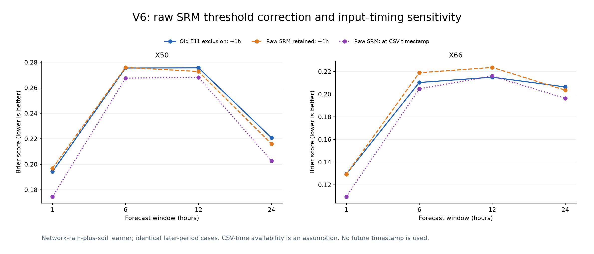

# V6 update: E11 threshold flags and CSV timestamp assumptions

E11 is treated as the user-described threshold flag. A finite positive raw srm value is retained under E11, while sm remains unavailable. Rainfall labels, original validation routing, model parameters and scoring case IDs are unchanged.

## UTC time versus availability

The CSV timestamp_ms is a Unix-millisecond timestamp. The time_WIB column is the same assigned instant displayed in UTC+7. For example, X66 timestamp 1786008008000 is 6 August 2026 09:20:08 UTC, or 16:20:08 WIB. The CSV does not identify whether that assigned time came from device measurement or server receipt, and it has no separate arrival timestamp.

The earlier one-hour receipt delay was a conservative assumption, not a fact established by the file. This update holds rainfall label availability and case partitions fixed, and compares past features under two assumptions: availability at assigned CSV time, or one hour later. The immediate-time case is a sensitivity, not confirmation of live delivery latency. Even there, no reading timestamped after the forecast issue is used.

## Threshold handling

| Station | E11 rows | Numeric raw srm present | Raw range during E11 | Unflagged srm below 7000 |
| --- | ---: | ---: | --- | ---: |
| X50 | 29 | 0 | — | 1082 |
| X66 | 143 | 143 | 3484–4996 | 294 |

The approximate 7000 threshold is not hard-coded or used to recompute flags. Device flags and raw-value presence determine handling. This restores 143 X66 raw ADC readings. X50 missing raw ADC readings stay missing; no zero or inferred sm value replaces them.

With this correction, the valid one-hour soil-response examples are:

| Station | Rain onsets checked | Any srm decline within one hour | Decline at least 5% |
| --- | ---: | ---: | ---: |
| X50 | 65 | 53 | 19 |
| X66 | 41 | 33 | 10 |

These are retrospective soil responses, not forecast inputs from the future. The correction does not make every rain episode show a soil drop, or identify the cause of every drop without rain.

## Fixed-routing rainfall forecast comparison

| Station | Window h | Old selected RMSE | Raw-srm selected RMSE, +1h | Raw-srm selected RMSE, CSV time |
| --- | ---: | ---: | ---: | ---: |
| X50 | 1 | 2.551 | 2.554 | 2.518 |
| X50 | 6 | 10.502 | 10.529 | 10.423 |
| X50 | 12 | 12.583 | 12.597 | 12.490 |
| X50 | 24 | 15.998 | 15.946 | 15.957 |
| X66 | 1 | 1.469 | 1.469 | 1.437 |
| X66 | 6 | 5.648 | 5.648 | 5.648 |
| X66 | 12 | 9.194 | 9.194 | 9.194 |
| X66 | 24 | 15.668 | 15.668 | 15.668 |

Some selected probability/amount routes are weather-only or climatology controls, so those outputs do not change with soil policy or timing. The figure below directly compares the network-rain-plus-soil learner to isolate these input assumptions.

The same two weekly fit dates, same rainfall targets and same later-period cases are used. Only soil-field handling and then-available feature timing vary. Model routing is not reselected using the later outcomes. This follows prior inspection of those outcomes and is development evidence, not an untouched test.

## Models and files

- The E11-corrected final models with the conservative timing assumption are in [raw_srm_1h/models/final/](raw_srm_1h/models/final/).
- CSV-time models are timing-sensitivity fits, not a confirmed live-production configuration.
- [Comparison table](comparison.csv), [restored pattern analysis](corrected_pattern_analysis.json), [threshold profile](threshold_profile.json).
- [Training audit](training_audit.json) and [feature availability](feature_availability.json) record the cutoffs and timestamps.
- Temperature/humidity and every prior frozen experiment remain unchanged. No GitHub publication is performed.
