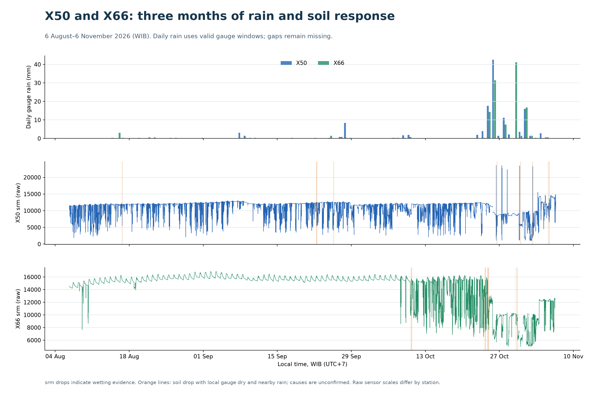
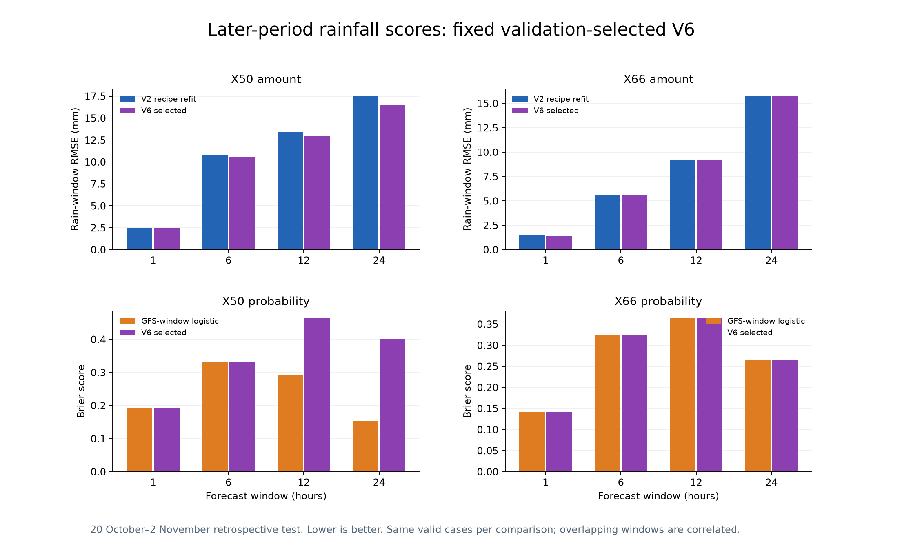
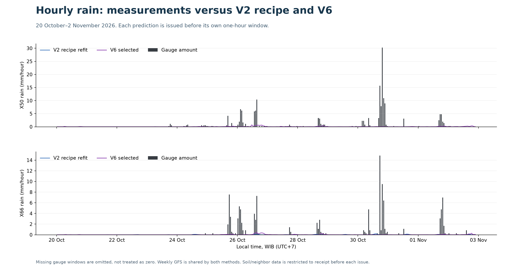

# V6 rainfall research: X50 and X66

**The validation-selected V6 candidate has lower later-test amount RMSE in 5/8 station/window groups than the past-only V2 recipe refit, and lower Brier score in 1/8 groups than the GFS-window logistic control.**

These are retrospective, hourly-issued 1/6/12/24-hour forecasts. Weekly GFS snapshots are reused between their recorded issue times. This is a different evaluation from the original once-issued seven-day V2/V5 benchmark; the original final V2 parameters are not applied to earlier test outcomes.

## Three months of rain and soil patterns

The supplied station coordinates put X50 and X66 about **3.56 km apart**. Nearby data supplies additional context, while each station retains its own independent gauge labels.

| Station | Readings | Raw rf total mm | Checked ten-minute mm | Complete-hour mm | Gaps >15 min |
| --- | ---: | ---: | ---: | ---: | ---: |
| X50 | 13049 | 203.56 | 202.72 | 198.80 | 33 |
| X66 | 13226 | 124.88 | 124.88 | 124.60 | 2 |

The complete-hour totals cover different valid periods and are not complete three-month rainfall estimates. Gauge counter boundaries can recover additional whole-window totals when record-ID continuity verifies missing packets; the timings of tips within those gaps remain unknown.

| Station | Rain onsets with valid 1h soil response | Any srm drop within 1h | Drop ≥5% within 1h | Drop ≥5% with neither gauge wet nearby |
| --- | ---: | ---: | ---: | ---: |
| X50 | 65 | 53 | 19 | 391 hourly cases |
| X66 | 35 | 29 | 8 | 96 hourly cases |

Rain does not produce a measured srm decrease in every eligible episode. Small decreases also occur in dry gauge intervals; a drop alone cannot distinguish rain from manual fertigation, local wetting, sensor noise or a missed gauge event. No fertigation logs or independent rain truth were supplied, so the possible causes remain unconfirmed. E11 soil faults are excluded even if raw srm is present.

Across 2136 jointly complete gauge hours, both stations were wet in 46 hours; X50 alone was wet in 74 and X66 alone in 16. Hourly amount correlation is 0.810. Time lags and localized rain can affect this overlap; it does not justify copying rainfall quantities.

## Forecast comparison on the later period

Training labels and receipts end before 1 October. Model families/components are selected using 1–19 October. The fixed selection is then scored on 20 October–2 November, with boundary windows purged if their labels arrived too late. The source dataset was explored retrospectively; this is research evidence, not prospective validation.

| Station | Window h | Cases | Wet cases | V2 recipe RMSE mm | V6 RMSE mm | GFS logistic Brier | V6 Brier |
| --- | ---: | ---: | ---: | ---: | ---: | ---: | ---: |
| X50 | 1 | 301 | 72 | 2.475 | 2.449 | 0.19230 | 0.19336 |
| X50 | 6 | 287 | 147 | 10.800 | 10.586 | 0.33044 | 0.33044 |
| X50 | 12 | 271 | 181 | 13.434 | 12.975 | 0.29369 | 0.46312 |
| X50 | 24 | 240 | 179 | 17.468 | 16.531 | 0.15320 | 0.40116 |
| X66 | 1 | 332 | 50 | 1.445 | 1.435 | 0.14192 | 0.14095 |
| X66 | 6 | 317 | 116 | 5.646 | 5.646 | 0.32312 | 0.32312 |
| X66 | 12 | 299 | 144 | 9.188 | 9.188 | 0.36328 | 0.36328 |
| X66 | 24 | 267 | 161 | 15.710 | 15.710 | 0.26489 | 0.26489 |

RMSE compares expected rainfall amount with measured window totals. Brier compares the probability of at least 0.28 mm anywhere in the whole window with its observed event. Longer-window probabilities are trained directly, never obtained by adding hourly probabilities. Overlapping windows share observations and are not independent storms. The counts above are issued forecast cases.

## Validation-selected methods

| Station | Window h | Amount method | Probability method |
| --- | ---: | --- | --- |
| X50 | 1 | local_rain_soil | local_rain_soil |
| X50 | 6 | local_rain_soil | gfs_logistic |
| X50 | 12 | local_rain_soil | training_climatology |
| X50 | 24 | local_rain_soil | training_climatology |
| X66 | 1 | local_rain | network_rain_soil |
| X66 | 6 | v2_recipe | gfs_logistic |
| X66 | 12 | v2_recipe | gfs_logistic |
| X66 | 24 | v2_recipe | gfs_logistic |

Five LightGBM hurdle families have identical training cases and fixed settings: GFS only; own recent rain; own rain plus soil; own/neighbor rain; own/neighbor rain plus soil. Continuous srm/sm levels, changes and measurement ages are predictors. Soil readings after issue time never enter features. The V2 amount control refits its original method on the same past period; separate GFS-logistic and training-climatology controls support window probabilities.

See [all validation scores](validation_scores.csv) and [all later-test ablations](test_scores.csv). A validation improvement may not carry over to later dates. Selected amount and probability components are separate estimates; cross-window/joint-distribution coherence is not established.

## Missing data and gauge evidence

786 overlapping forecast-window labels were recovered from valid cumulative-counter boundaries and continuous device record IDs. This count is not a number of independent storms. Reset or discontinuous-device periods remain missing. Neighbor observations and soil drops never create target labels.

The [soil/rain flags](soil_rain_flags.csv) identify possible gauge disagreements and ambiguous wetting. They are diagnostics, not corrected rainfall measurements. Any use of future soil response in the pattern analysis is retrospective only and is excluded from the predictive feature schema.

## Frozen outputs and limitations

- Final selected rainfall components are refitted using only cases/label receipts before 3 November midnight WIB. The saved initial forecasts are whole windows from the same original 3 November issue and GFS run.
- Later-period scores above use the pre-October training fits, not these final refitted models.
- November replay results are a separate development diagnostic. These hourly updates may use earlier November observations available at their own issue times; they are not forecasts all issued on 3 November.
- V5 temperature and humidity are copied unchanged for all 672 rows. No temperature/humidity learners are fitted.
- Historical GFS publication and observation-plus-one-hour receipt timing are assumptions. Fresh operational GFS updates and confirmed fertigation logs are not present.
- Nothing is pushed to GitHub by this experiment.

Files: [source quality](source_quality.json), [pattern analysis](pattern_analysis.json), [training audit](training_audit.json), [feature availability](feature_availability.json), [frozen window forecasts](frozen_window_forecasts.csv), [November diagnostic](november_diagnostic_scores.csv), [model catalog](model_catalog.json).
