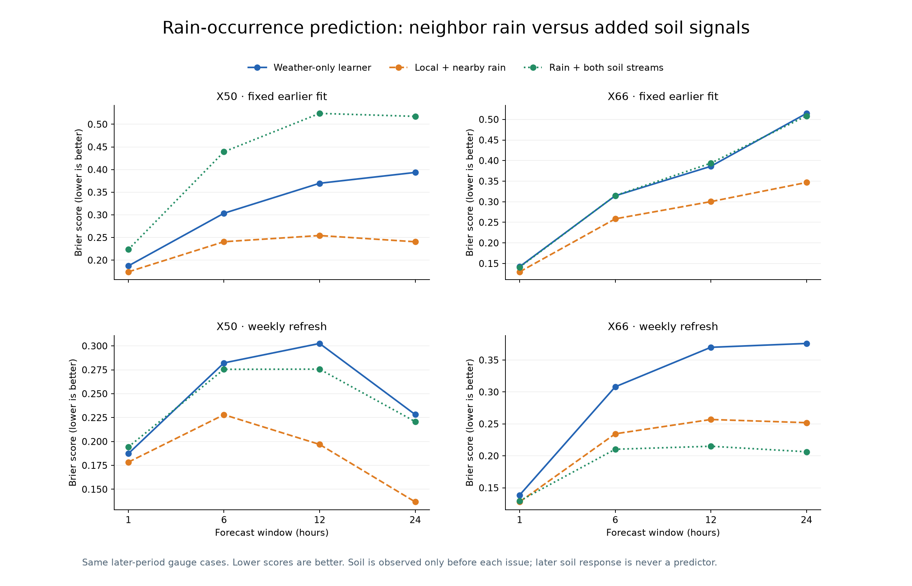
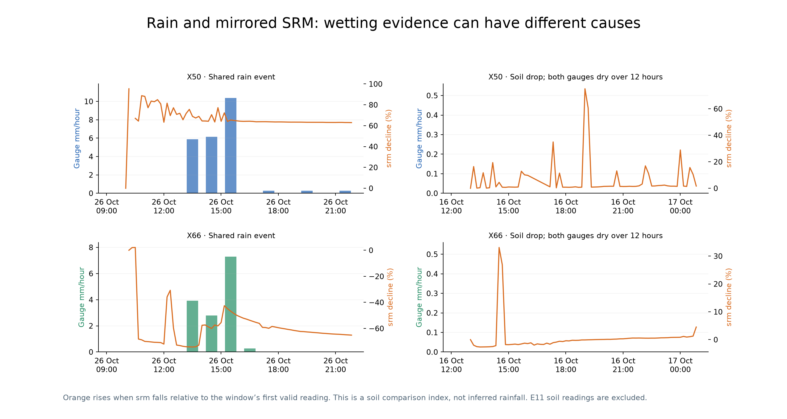

# V6 review: useful rain evidence, limited forecast gains

**V6 remains an experimental candidate. The soil hypothesis does not yet establish a consistently more accurate rainfall forecast.**

Nearby recent rain helps the rain-occurrence models more consistently than adding all soil signals. Rainfall amount must also be compared with raw GFS; improvement over a dry-period V2 recipe refit alone is insufficient.

| Evaluation | V6 amount better than V2 recipe | V6 amount better than raw GFS | Nearby-rain Brier better than weather-only learner | Adding network soil improves Brier |
| --- | ---: | ---: | ---: | ---: |
| Original fixed pre-October fit | 5/8 | 1/8 | 8/8 | 0/8 |
| Weekly refresh follow-up | 3/8 | 0/8 | 8/8 | 3/8 |

The weekly follow-up preserves the original validation-selected routing and model settings. It refits on data available before 20 and 27 October. This schedule was investigated after inspecting the first results, so it is another development diagnostic, not an untouched validation. No first-experiment model, selection or score was overwritten.

## What the sensors show

- In valid onset examples, an srm decrease appeared within one hour for 53/65 X50 and 29/35 X66 rain onsets. A decline of at least 5% appeared in 19/65 and 8/35 respectively.
- There are 391 X50 and 96 X66 hourly cases with at least a 5% srm drop and neither checked gauge recording rain nearby. These overlapping cases are unconfirmed wetting, not confirmed fertigation events.
- Both checked gauges were wet in 46 shared hours; X50 alone in 74 and X66 alone in 16. The sites are 3.56 km apart, so neighbor measurements add context without becoming the target station’s rainfall labels.
- Valid cumulative counters recover whole-window rain totals across missing packets. The first experiment recovered 786 overlapping window labels; within-gap rain timing stays unknown.

The mirrored soil index is the percentage srm decline from the beginning of each plotted window. It is only a visual comparison, not rainfall millimetres. The wet example uses a strong shared gauge event with adequate soil coverage; the dry example uses a large soil decline inside a 12-hour window with both gauges at zero. Neither plot identifies the irrigation cause.

## Interpretation for the next V6 iteration

Treat srm/sm as wetting and gauge-consistency signals, and evaluate their incremental value alongside recent local/neighbor rain. Do not convert a soil decline into a rain amount or replace a dry/missing gauge with its neighbor. The late-October period was much wetter than the earlier validation: X50 one-hour wet frequency rose from 2.47% to 23.92%, and X66 from 1.10% to 15.06%. The fixed dry-period fit therefore gives a weak amount control; the separate raw-GFS comparison is essential.

All feature replays currently assume a one-hour receipt delay. Arrival timestamps and confirmed fertigation logs are absent. Fresh delivery timing may change near-term usefulness and should be checked before treating these as live forecasts. E11 also needs clarification: X66 retains numeric raw srm below 5000 while sm is blank. The current models exclude those soil readings; an unconfirmed raw-ADC-only sensitivity is recorded separately and does not alter these model fits.

## Files

- [Original experiment report](../rainfall_candidate_20261106/report.md)
- [Three-month overview](../rainfall_candidate_20261106/rain_soil_patterns_3months.png)
- [Original validation/test ablations](../rainfall_candidate_20261106/test_scores.csv)
- [Weekly follow-up scores](../rolling_refresh_20261106/scores.csv)
- [Control comparison](control_comparison.csv), [independent verification](independent_verification.json)

V2/V3/V4/V5 remain unchanged. V5 temperature and humidity pass through bit for bit. Nothing was pushed to GitHub.
