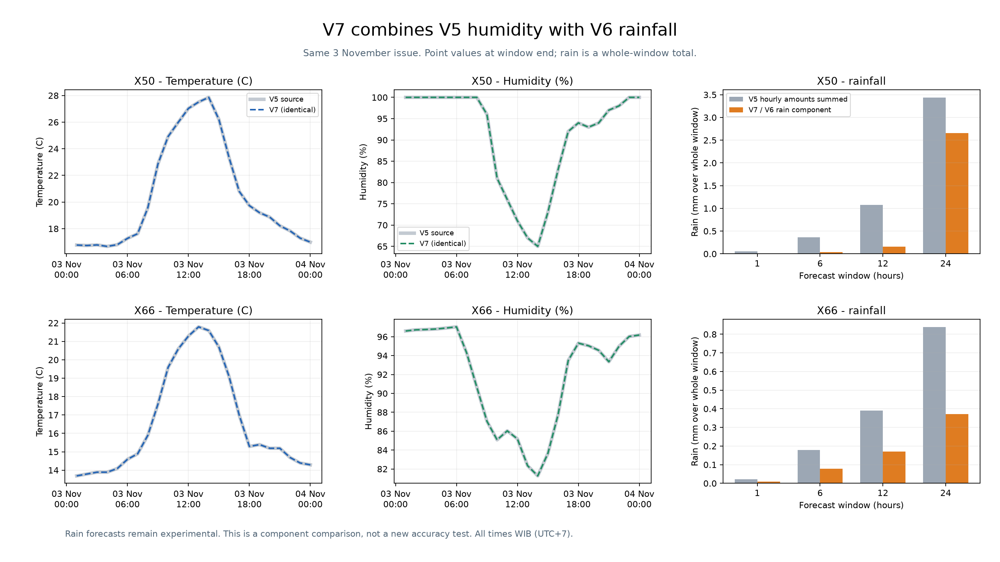

# Engine V7: V5 humidity + V6 rainfall

V7 combines **V5 humidity** and the **E11-corrected V6 rainfall candidate**.
Temperature keeps the V2 values already passed through V5. The component models
are reused exactly; V7 does not retrain them or claim an additional accuracy gain.

This package lives in its own top-level `v7/` folder on `main`.
All earlier versions and frozen results are preserved.

## Components and station coverage

| Output | X50 | X66 | X51 / X67 |
| --- | --- | --- | --- |
| Temperature | V2 via V5 | V2 via V5 | Existing V2/GFS fallback via V5 |
| Humidity | Existing V2 via V5 | V5 equal-third V2/CatBoost/LightGBM ensemble | Existing V2/GFS fallback via V5 |
| Rain amount | Corrected V6 selected routes | Corrected V6 selected routes | Existing V5/V2 hourly amounts summed over each window |
| Rain probability | Corrected V6 selected routes | Corrected V6 selected routes | Existing one-hour probability; multi-hour probability is null |

V5's humidity update is specific to X66. V6's rainfall component is specific to
X50/X66 and includes weather-only, climatology and V2-recipe routes where validation
selected them. The [architecture and routing table](docs/ARCHITECTURE.md) records
which method provides each output.

## Included forecasts and models

The retrospective snapshot uses **3 November 2026 00:00 WIB** as its issue and
the archived GFS run initialized on **2 November 2026 06:00 UTC**.

- **672 hourly temperature/humidity points:** 168 hours at each of four stations,
  exactly matching V5.
- **16 combined forecasts:** four stations × 1/6/12/24-hour windows.
  Temperature/humidity are values at the window end; rain is the total over
  the entire window.
- **16 copied component files:** trained humidity/rain models, selections and
  V2 parameters, with source hashes recorded in the frozen audit.
- A saved, past-only rainfall feature snapshot and repeatable model inference.
  Raw station CSVs and runtime caches are excluded from this publication.



The overlapping temperature/humidity lines are identical. Rain bars compare
V5 hourly amounts summed to the same windows with the V6 component used by V7.
**This graph compares predictions; it does not measure accuracy.**

Read the [composition report](output/merged_candidate_20261106/report.md),
[combined forecasts](output/merged_candidate_20261106/merged_forecasts.csv),
[seven-day point values](output/merged_candidate_20261106/hourly_temperature_humidity.csv),
[model inventory](models/README.md), and [publication manifest](publication.json).

## Verify and replay

Use the full monorepo checkout and run from its root. Python 3.12 was tested.

```sh
# Standard library only; no training CSV or ML runtime needed.
python -m unittest discover -s v7/tests -v
python v7/verify_package.py
# Install the pinned replay/build dependencies in your Python environment.
python -m pip install -r v7/requirements.txt
# Re-run copied V6 models against the saved feature snapshot.
python v7/run.py replay
```

Verification checks the publication hashes, **32 frozen V7 files**,
**535 earlier frozen files**, exact V5 values, copied models and composition.
The replay reproduces all eight X50/X66 rain-window predictions. See
[validation evidence](docs/VALIDATION.md) for what these checks cover.

The [usage guide](docs/USAGE.md) explains the Python API, input/output fields,
dependencies, one-time build and requirements for a fresh forecast issue.

## Limitations

- V6 rainfall is **experimental** and has not consistently improved rain amount
  over raw GFS. V7 has no new combined accuracy benchmark.
- The bundled forecast is a **retrospective November snapshot**, created after
  November observations had been revealed, rather than a current live forecast.
- Improved humidity is supported at X66; the V6 rain component covers X50/X66.
  Improvement at the other stations is not established.
- Rain windows overlap and are modeled separately. Do not add their totals,
  divide them into guessed hourly rain, or assume a coherent joint distribution.
- Multi-hour rain probabilities for X51/X67 are **null**, not zero.
- The inherited **one-hour reading-availability delay is an assumption**.
  CSV timestamps do not establish separate measurement and arrival times.
- Soil wetting can be rain or manual fertigation. An SRM drop cannot by itself
  identify rain or determine rainfall millimetres.
- V7 is a composition package with sibling-version dependencies. It does not
  download new weather data, schedule forecasts or retrain models automatically.

Read [all limitations and interpretation rules](docs/LIMITATIONS.md) before
comparing versions or applying the forecasts to a new issue or station.

## Documentation

- [Architecture and selected component routes](docs/ARCHITECTURE.md)
- [Usage, inputs and outputs](docs/USAGE.md)
- [Limitations and evaluation boundaries](docs/LIMITATIONS.md)
- [Validation and reproducibility](docs/VALIDATION.md)

Historical frozen reports keep their original pre-publication statements and paths.
The publication manifest describes the published package; build and replay
commands themselves do not publish to GitHub.
