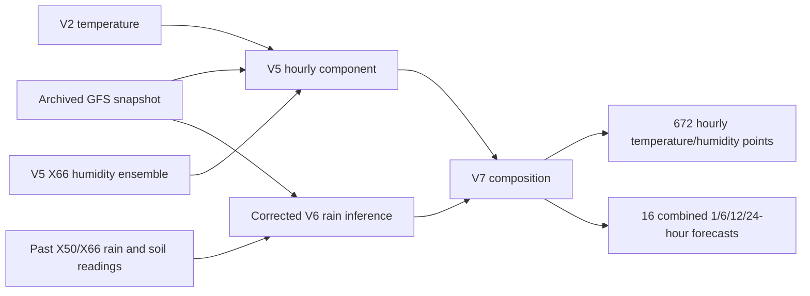

# V7 architecture

V7 is a composition layer over existing models. Its public API accepts already
computed V5 hourly forecasts and V6 rain-window forecasts with a common issue time.
It does not train a joint model.

The counts above describe the included four-station snapshot. New input streams
must satisfy the API's time, coverage and value checks.

## Component definitions

**Temperature:** V5's frozen temperature values are copied exactly. They already
retain V2 temperature; this work does not change temperature training or its
sensor reference.

**Humidity:** V5 is copied exactly. At X66, its selected ensemble has one-third
weight each on V2 humidity and the V5-retrained CatBoost and LightGBM learners
targeting `hsht`. These are the humidity learners already trained for V5,
rather than the original V3/V4 predictions. Other stations retain V5's fallbacks.

**Rain:** the chosen component is V6's E11-corrected final model set with the
inherited assumed +1h feature availability. The CSV-time sensitivity is not used.
Numeric positive raw `srm` under E11 is retained; missing `sm` remains missing.
The approximate 7000 threshold is not hard-coded.

## Selected rainfall routes

The original V6 validation selection is preserved. Amount and probability can
come from different selected methods.

| Station | Window, h | Amount | Probability |
| --- | ---: | --- | --- |
| X50 | 1 | local_rain_soil | local_rain_soil |
| X50 | 6 | local_rain_soil | gfs_logistic |
| X50 | 12 | local_rain_soil | training_climatology |
| X50 | 24 | local_rain_soil | training_climatology |
| X66 | 1 | local_rain | network_rain_soil |
| X66 | 6 | v2_recipe | gfs_logistic |
| X66 | 12 | v2_recipe | gfs_logistic |
| X66 | 24 | v2_recipe | gfs_logistic |

The V6 `v2_recipe` here is its past-data refit saved in the V6 rain baseline,
not substitution of the original V2 benchmark's hourly predictions.
`gfs_logistic` is a direct window-occurrence learner; climatology is a past
window-frequency control. Soil is therefore not used in every selected output.
See [the copied routing file](../models/rainfall_selection.json).

For X51/X67, V7 sums existing hourly V5/V2 amounts over each requested window.
Their one-hour probability is retained; longer-window probability is unavailable.

## Time alignment and code

[composition.py](../composition.py) checks a common issue, matching rain end times,
complete requested coverage, duplicate keys and rain-value bounds. It takes
temperature/humidity from `issue + horizon × 3600` and copies the selected V6
rain-window amount/probability without summing the V6 windows.

[rainfall_worker.py](../rainfall_worker.py) runs the existing V6 inference code in
a separate Python process and uses V7's copied model files. This avoids collisions
between earlier versions' module names. Fresh rain features are built only by
the one-time build; replay uses the saved feature snapshot.

[run.py](../run.py) builds, verifies and replays the snapshot. Model-run initialization
and archived forecast-snapshot issue are recorded separately; V6's snapshot-age
feature convention is retained.

The full monorepo supplies V6 inference helpers and V2 primitives. V7 is not an
independent live forecasting service. See [usage](USAGE.md) and
[limitations](LIMITATIONS.md).
