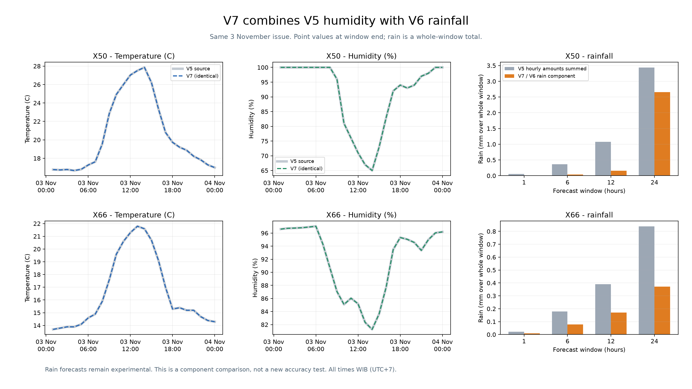

# V7: V5 humidity + V6 rainfall

V7 combines the existing component models. Temperature remains V2, humidity
retains V5 exactly, and X50/X66 rainfall uses the E11-corrected final V6 models
with the inherited assumed one-hour observation delay. No model is retrained.

The issue is 3 November 2026 00:00 WIB, using the same archived GFS input.
This is a retrospective snapshot built after November observations were seen,
not a new live forecast or untouched accuracy test.

There are 672 unchanged hourly temperature/humidity points and 16 combined
station/window forecasts. Temperature and humidity are values at each window
end; rain amount is the total over the whole 1/6/12/24-hour window.

X51/X67 retain their existing V5/V2 hourly rain amounts summed over each window.
Only the one-hour probability is available for those stations. Multi-hour
fallback probabilities are null, because hourly probabilities cannot be summed.

The V5 humidity improvement applies at X66. The V6 rain component applies at
X50/X66 and still includes the original validation-selected weather-only and
V2-recipe fallback routes. Combining the components does not establish a new
accuracy improvement; V6 amount has not consistently beaten raw GFS.

The rain bars compare inherited V5 hourly amounts summed to the same windows
with the V6 component now used by V7. They are predictions, not accuracy scores.
Overlapping temperature/humidity lines have identical values.

See [merged forecasts](merged_forecasts.csv), [seven-day point values](hourly_temperature_humidity.csv),
[exact component copies](component_copies.json), and [feature snapshot](rainfall_feature_snapshot.json).

Run `python v7/run.py verify` without ML dependencies.
Run `python v7/run.py replay` with the LightGBM runtime to re-run rain inference.
All earlier versions are preserved. Nothing in this build publishes to GitHub.
